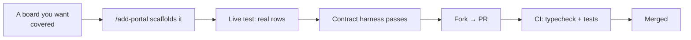

# Contributing

Thanks for considering a contribution! This repo has a deliberate, narrow philosophy, and most declined PRs are well-executed work that simply didn't know about it. Read this first; it will save you effort and tell you where your work will land best.

## The one rule everything follows from

**This repo is one specific edition of a general framework**: the ApplyOS pipeline (self-profiling, fit evaluation, drafter-reviewer application workflow) pointed at the Indian tech market and global-remote roles, runnable under any AI coding agent. A contribution is judged by fit to that identity first, execution quality second. Well-built but off-policy still gets declined (kindly, with reasons).

## What gets merged

- **Robustness and correctness fixes** with the failing case demonstrated on the real code path.
- **Portal skills and improvements for the covered markets** (India tech & early-career, global remote, employer career portals), following the portal-skill contract below.
- **Runtime adapter improvements** that keep the thin-pointer invariant: every runtime reaches the same canonical specs under `.claude/` without a second copy of any workflow.
- **Docs that close real gaps** or correct drift between the specs and what the code actually does.
- **Infrastructure that reduces review burden** and is argued from evidence, not speculation.

## What gets declined

- **Portals or content for markets this edition does not target.** They belong in your own private checkout — the framework's `/add-portal` command exists exactly for that, and the shipped skills are the reference for the contract.
- **Personal profile data.** The repo ships placeholders; your populated profile lives in your private checkout. CI enforces this (placeholder-integrity and security-guards jobs).
- **A second copy of a workflow.** The markdown specs under `.claude/` ARE the implementation; adapters under `.opencode/` must remain thin pointers (enforced by `tests/test_runtime_adapters.py`). An embedded copy drifts from its source the moment either changes — this repo has lived that failure with earlier Codex wrappers, and it is not welcome back. (The Cline, Cursor, and Gemini CLI adapters were removed 2026-10-07; supported runtimes are OpenCode, Claude Code, Codex CLI, Antigravity, ZCode, FreeBuff.)
- **Speculative infrastructure.** Complexity must be argued from a problem that exists, not one that might.
- **Kitchen-sink PRs.** One concern per PR; bundles get asked to split.

## The bar for new commands

The core lifecycle is **feature-complete**: `/setup` → `/scrape` → `/rank` → `/apply` → `/interview` → `/outcome` → calibration back into `/setup`, with `/expand`, `/upskill`, `/add-template`, `/add-portal`, and `/reset` around it. Every stage of a real job hunt has an owner.

A new command therefore faces a high bar. The test that admitted the existing ones: **does it operationalize something error-prone that already exists in the framework** (documented machinery nothing executes, data something writes but nothing reads)? "Useful" and "possible" are not sufficient; the strongest proposals connect two things that already exist without modifying either.

## Claims get verified

Reviews here are empirical. Bug reports are reproduced before the fix is considered; "all tests green" is checked against whether the tests can distinguish the old behavior from the fix. PRs whose premise doesn't reproduce get declined even when the code is fine. You can make this fast:

- State the failing case and how to reproduce it.
- **Reproduce on the real path, not a constructed input.** The failing input has to be one the workflow actually produces — the documented CLI invocation, real portal output, an actual data file — not a synthetic value fed straight to the function.
- Put CLI tests in `.agents/skills/<name>/cli/tests/` (bun test, network-free where possible); Python tool tests in `tests/`.
- Run what CI runs: `python tools/lint_skills.py`, `python tools/security_guards.py`, `python -m unittest discover -s tests`, and in touched CLIs `bun run typecheck` + `bun test`.

**Credit norm:** a change that incorporates your actual code gets a `Co-authored-by` trailer; a change written independently from your observation or report gets a named mention in the commit message. Both happen unprompted.

## Building for a different market or your own profile?

1. Keep your populated profile, tracker, and `input/` in a **private** checkout — never push them (see the warning in SETUP.md section 2).
2. For a job board this edition doesn't cover, run `/add-portal` in your own private checkout — it scaffolds a portal skill matching the shipped contract, and `/scrape` picks it up automatically.
3. ApplyOS is standalone: there is no upstream remote to track and none to add. The derivation credit in [NOTICE](NOTICE) and the README acknowledgements is permanent — contributions must keep it intact (see "Attribution" below) but never reintroduce sync machinery against the original project.

Market-specific skills are genuinely valuable — they just belong where their maintainers can test them and their users can find them.

## Contributing a portal: the funnel

Adding a board is a short, documented path. You never need to read the engine's source.

| Step | What you run | "Done" looks like |
|---|---|---|
| 1. Scaffold | `/add-portal` in your AI coding agent | `.agents/skills/<board>-search/` with `SKILL.md`, `cli/`, a contract test and `url-reference.md` |
| 2. Live test | `cd .agents/skills/<board>-search/cli && bun run src/cli.ts search --format json` | Real rows from the board, with the neutral `{meta, results}` envelope |
| 3. Contract harness | `bun run typecheck && bun run test` in that CLI | Zero-dependency; the captured fixture passes; no live calls in the test |
| 4. One-command check | `python tools/check_contribution.py` (or `scripts/check.sh` / `scripts/check.ps1`) | "All offline checks green" — the same checks CI runs |
| 5. Fork → PR | Open a PR with one concern | The board is in a market this edition targets (India tech / global remote / employer portals) |
| 6. CI | automatic | `example-provider`, `cli-checks`, `applyos-checks`, `lint`, `spec-conformance`, `security-guards`, `docs`, `eval`, `python-tests` all green |
| 7. Merged | maintainer merges | `/scrape` discovers the new CLI automatically via `.agents/skills/*/SKILL.md` |

**Worked example.** [examples/example-search/](examples/example-search/) is a complete, minimal, heavily commented provider (Arbeitnow) you can copy. Its contract harness is [contract.test.ts](examples/example-search/cli/tests/contract.test.ts) — replace the fixture with *your board's captured response*, never with output generated by the code under test (that would make the harness rubber-stamp itself). The full walkthrough is in [docs/developer/adding-a-portal.md](docs/developer/adding-a-portal.md).

**Scope reminder.** A board outside this edition's markets belongs in your private checkout, not a PR — see the section above. Publishing is deliberately deferred (Q6 in [docs/OPEN_QUESTIONS.md](docs/OPEN_QUESTIONS.md)); distribution is "clone the repo", so contributing means cloning and opening a PR.

## Practical notes

- **Portal-skill contract**: `search`/`detail` commands, `--format json|table|plain`, `{meta, results}` JSON output, stderr JSON errors with exit 1, backoff on 429/5xx, zero runtime dependencies, a `url-reference.md` with the parsing anchors, and offline tests. See `/add-portal`'s spec and `linkedin-search` as the reference implementation.
- **Runtime-adapter contract**: adapters point at canonical specs, never copy them (see `tests/test_runtime_adapters.py` — it covers OpenCode and the `.agents/skills/source-command-*` mirrors); a new command needs its routing row in `AGENTS.md` plus an OpenCode adapter in the same change.
- **Personal-use boundaries**: portal skills that touch ToS-restricted sources carry a prominent personal-use-only warning, and CI deliberately makes no live portal requests. Don't "fix" that.
- **LaTeX changes**: both stock templates (`templates/cv-stock/main_example.tex`, the 2-page CV, and `templates/cv-stock/resume_example.tex`, the hard 1-page resume) must compile with `lualatex` and hold their exact page counts. CI smoke-checks both on both TeX legs.

## Attribution

The core application pipeline descends from [MadsLorentzen/ai-job-search](https://github.com/MadsLorentzen/ai-job-search) (MIT). This edition is licensed to its contributors under MIT; the derivation and lineage are recorded in [NOTICE](NOTICE) and the README acknowledgements, and contributions keep that record intact.
