# ApplyOS — Master Engineering Blueprint

> **Audience:** engineers, contributors, and maintainers of ApplyOS.
> **Status of this document:** `PROPOSED` — it is a plan, not a description of shipped behaviour.
> **Evidence basis:** repository state at commit `78813db` (2026-10-13), verified locally on 2026-11-13.
> **Companion documents:** [IMPLEMENTATION_STATUS.md](./IMPLEMENTATION_STATUS.md) · [DECISION_LOG.md](./DECISION_LOG.md) · [OPEN_QUESTIONS.md](./OPEN_QUESTIONS.md) · [CHANGE_IMPACT_MATRIX.md](./CHANGE_IMPACT_MATRIX.md)

---

## 1. What ApplyOS is

ApplyOS is a **privacy-first, local-first job-search platform** for students, early-career
professionals, and developers. It scrapes job boards, evaluates postings against a candidate
profile, produces tailored ATS-readable documents, tracks applications, and prepares interview
material.

Two properties define the project and are not negotiable:

1. **Nothing leaves the machine.** The candidate profile, the tracker, the tailored documents,
   the application archive, and salary data are local files. There is no backend, no account,
   and no telemetry.
2. **The workflow is the product.** ApplyOS is not an application with a UI; it is a set of
   **specifications** that any AI coding agent can execute. The agent is a runtime, not a
   dependency — the goal is that the same job search can be driven from OpenCode, Claude Code,
   Codex CLI, Antigravity, ZCode, FreeBuff, or a future runtime without changing the workflow.

### 1.1 Vision

> A deterministic core that any runtime can drive, an extension surface any developer can
> plug into, and job intelligence that is explainable enough to argue with.

### 1.2 Scope boundaries

| In scope | Out of scope |
|---|---|
| Job discovery, evaluation, document generation, tracking, interview prep | Hosted multi-tenant service, accounts, sync backend |
| Personal-use crawling of public and documented endpoints | Bulk commercial data collection, evading blocks |
| English-only, single-language documents | Multi-language CV generation (a deliberate v1 exclusion — see `search-queries.md`, "Language Filter") |
| Local provider CLIs and an in-repo engine | A general-purpose job-board marketplace |

---

## 2. The three systems

ApplyOS currently consists of **three cooperating systems** that were built at different times
and for different reasons. Understanding their boundaries is the single most important thing
for a new contributor.

```mermaid
flowchart TB
  subgraph spec["SPEC LAYER — canonical, markdown"]
    CMD[".claude/commands/*.md<br/>12 workflow specs"]
    SK[".claude/skills/*/SKILL.md<br/>9 methodology skills"]
    QUERY[".claude/skills/job-scraper/search-queries.md<br/>Stage Profile + portal sets"]
  end

  subgraph adapt["ADAPTER LAYER — thin pointers, no workflow content"]
    OC[".opencode/command/*.md"]
    CODEX[".codex/agents/*.toml"]
    MIR[".agents/skills/source-command-*"]
  end

  subgraph eng["ENGINE — applyos/ Bun + TypeScript"]
    CLI["apps/cli<br/>scrape · rank · apply"]
    CORE["packages/core<br/>types · fetch · robots · dedupe"]
    PORT["packages/portals<br/>6 aggregator adapters"]
    CS["packages/company-scraper<br/>5 ATS connectors"]
    MATCH["packages/matching<br/>7 gates + scoring"]
    DOCGEN["packages/docgen<br/>application pack"]
  end

  subgraph tool["TOOLING — tools/ Python 3, stdlib only"]
    RS["rank_state.py"]
    VP["verify_pdf.py"]
    SG["security_guards.py"]
    LS["lint_skills.py"]
    RB["robots_check.py"]
    CFV["check_framework_version.py"]
  end

  subgraph providers["PROVIDER CLIs — .agents/skills/*-search/cli"]
    P1["naukri · internshala · unstop<br/>wayup · wellfound · cutshort"]
    P2["linkedin · remoteok · remotive<br/>weworkremotely · freehire"]
    P3["careers-search<br/>8 ATS connectors"]
  end

  subgraph data["PERSONAL DATA — gitignored"]
    IN["input/"]
    WS["workspace/"]
    OUT["output/"]
  end

  CMD -.->|"agent executes"| OC
  CMD -.->|"agent executes"| CODEX
  CMD -.->|"agent executes"| MIR
  SK -.->|"agent executes"| QUERY
  QUERY -->|"portal set"| P1 & P2 & P3
  CMD --> RS & VP
  QUERY -->|"query template"| P1 & P2 & P3
  CMD & SK --> WS & OUT
  P1 & P2 & P3 --> WS
  CLI --> PORT & CS & MATCH & DOCGEN
  CLI -.->|"NOT WIRED — see ADR-0007"| CMD
  RS & VP & SG & LS & RB & CFV -->|"CI gates"| CMD

  classDef canon stroke-width:3px
  class CMD,SK,QUERY canon
```



### 2.1 System A — The spec layer (canonical)

The workflow logic is **prose**. `.claude/commands/*.md` (12 files) and `.claude/skills/*/SKILL.md`
(9 files) define exactly what happens at each step, what is read, what is written, which
external tools are invoked, and which contracts hold.

The 12 commands and the skills that back them are documented in
[architecture/current-state.md](./architecture/current-state.md#3-the-twelve-commands).

### 2.2 System B — The adapter layer (thin pointers)

`.opencode/command/*.md`, `.codex/agents/*.toml`, and `.agents/skills/source-command-*` contain
**no workflow content**. Each says, in effect, "read the canonical spec and follow it exactly".
This is the invariant that `tests/test_runtime_adapters.py` and `tests/test_skill_mirrors.py`
enforce in CI.

### 2.3 System C — The engine (`applyos/`)

A Bun/TypeScript monorepo that implements scrape/rank/apply **deterministically in code**. It
was built clean-room on 2026-10-07 (see `applyos/PROVENANCE.md`) and is documented in
[architecture/current-state.md](./architecture/current-state.md#4-the-engine).

> ### ⚠️ The engine and the spec layer are not connected
>
> No `.claude/commands/*.md` invokes the `applyos` binary. The two systems implement
> overlapping workflows independently. This is the single largest structural risk in the
> project and is the subject of **ADR-0007** (see [DECISION_LOG.md](./DECISION_LOG.md#adr-0007)).
> Phase 2 of the roadmap resolves it.

### 2.4 System D — Python tooling

Seven stdlib-only scripts under `tools/`. They are the *only* executable logic the spec layer
delegates to, and they are what CI asserts against.

### 2.5 System E — Provider CLIs

Twelve zero-runtime-dependency Bun CLIs under `.agents/skills/*-search/cli`. Each satisfies
the **portal-skill contract** (see [design/provider-sdk.md](./design/provider-sdk.md)).

---

## 3. Current state vs. target state

| Dimension | Current (`78813db`) | Target |
|---|---|---|
| Workflow execution | Agent reads markdown specs | Same, plus an optional deterministic engine path for scrape/rank/apply |
| Provider implementations | 12 provider CLIs **+** 6 engine adapters, 5 boards implemented twice | One implementation per board behind a shared SDK |
| Contracts | Portal-skill contract (provider CLIs); `JobPosting` (engine) | One versioned provider contract; `JobPosting` as the shared row type |
| Matching | Two systems: 4-dimension model-weighted scoring (spec) vs. 3-factor skill/title/freshness scoring (engine) | One explainable scoring model with a documented, versioned weight table |
| Documents | LaTeX/moderncv via `lualatex`, verified by `verify_pdf.py` | Unchanged — this is a strength, not a problem to solve |
| Privacy | Enforced by gitignore + `security_guards.py` in CI | Unchanged, plus a documented threat model and a data-flow inventory |
| Evaluation | None | Reproducible offline evaluation harness: gate precision, dedupe recall, document fidelity |
| Distribution | Git clone + `bun install` loop | Git clone + one bootstrap script; optional npm-published SDK later |
| Surface | 12 slash commands; one HTML report | Same commands, plus an optional `applyos` CLI (already exists) and a future local TUI |

The full comparison, with evidence, is in
[architecture/target-architecture.md](./architecture/target-architecture.md).

---

## 4. Architectural decisions

Eight decisions are recorded, five already in force and three proposed by this blueprint.
Full records live in [architecture/adr/](./architecture/adr/README.md); the one-line index is
[DECISION_LOG.md](./DECISION_LOG.md).

| ADR | Decision | Status |
|---|---|---|
| [0001](architecture/adr/0001-markdown-specs-are-the-implementation.md) | Markdown specs under `.claude/` are the implementation | accepted |
| [0002](architecture/adr/0002-thin-pointer-adapters.md) | Runtime adapters stay thin pointers | accepted |
| [0003](architecture/adr/0003-local-first-privacy.md) | Local-first privacy is a hard constraint, not a default | accepted |
| [0004](architecture/adr/0004-deterministic-core-optional-ai.md) | Deterministic core, optional AI orchestration | accepted |
| [0005](architecture/adr/0005-latex-document-pipeline.md) | LaTeX + `lualatex` is the document pipeline | accepted |
| [0006](architecture/adr/0006-portal-skill-contract.md) | Every provider ships to one contract | accepted |
| [0007](architecture/adr/0007-converge-engine-and-workflows.md) | Converge engine and spec layer onto one core | **proposed** |
| [0008](architecture/adr/0008-single-provider-implementation.md) | One implementation per board, behind the SDK | **proposed** |

---

## 5. How to read this blueprint

| If you want to… | Read |
|---|---|
| Understand what exists today | [architecture/current-state.md](./architecture/current-state.md) |
| Understand what it should become | [architecture/target-architecture.md](./architecture/target-architecture.md) |
| Know which module owns what | [architecture/system-design.md](./architecture/system-design.md) |
| Build a provider | [design/provider-sdk.md](./design/provider-sdk.md) + [developer/adding-a-portal.md](./developer/adding-a-portal.md) |
| Add a workflow | [design/product-requirements.md](./design/product-requirements.md) + [developer/writing-a-command.md](./developer/writing-a-command.md) |
| Write code that passes review | [engineering/standards.md](./engineering/standards.md) |
| Understand the test strategy | [engineering/testing.md](./engineering/testing.md) |
| Understand why a change is hard | [CHANGE_IMPACT_MATRIX.md](./CHANGE_IMPACT_MATRIX.md) |
| See what is planned | [roadmap/master-roadmap.md](./roadmap/master-roadmap.md) |
| Start implementing | [phases/README.md](./phases/README.md) → Phase 1 |
| Assess security posture | [security/threat-model.md](./security/threat-model.md) |
| Understand the privacy model | [security/privacy.md](./security/privacy.md) |
| See what is true vs. aspirational | [IMPLEMENTATION_STATUS.md](./IMPLEMENTATION_STATUS.md) |
| Compare against competitors | [research/competitive-analysis.md](./research/competitive-analysis.md) |

---

## 6. Documentation map

```
docs/
├── PROJECT_BLUEPRINT.md        ← you are here
├── IMPLEMENTATION_STATUS.md    ← status ledger (IMPLEMENTED / PARTIAL / …)
├── DECISION_LOG.md             ← ADR index + one-line decisions
├── CHANGE_IMPACT_MATRIX.md     ← module → blast radius
├── OPEN_QUESTIONS.md           ← unresolved, with owners
├── architecture/               ← current, target, system design, ADRs
├── design/                     ← product, SDK, plugin, API, CLI, UX, formats
├── engineering/                ← standards, testing, evaluation, performance
├── roadmap/                    ← master roadmap, dependencies, risks
├── phases/                     ← 12 sequential implementation plans
├── security/                   ← threat model, privacy, security testing
├── developer/                  ← onboarding, contributing, extension guides
└── research/                   ← competitive + ecosystem analysis
```

Pre-existing documents that remain authoritative and are **not** superseded by this blueprint:

- [`AUDIT_2026-10-09.md`](./AUDIT_2026-10-09.md) — the 2026-10-09 four-worker re-audit
- [`UPGRADES_2026-10-11.md`](./UPGRADES_2026-10-11.md) — the 2026-10-11 deep audit and upgrade backlog
- [`COMPANY_PORTAL_SCRAPER.md`](./COMPANY_PORTAL_SCRAPER.md) — verified ATS endpoints and the company-portal scraper design
- [`EXTERNAL_SOURCES_2026-10-10.md`](./EXTERNAL_SOURCES_2026-10-10.md), [`WEB_RESEARCH_2026-10-10.md`](./WEB_RESEARCH_2026-10-10.md)
- [`examples/`](./examples/) — shareable sample outputs
- [`../applyos/PROVENANCE.md`](../applyos/PROVENANCE.md) — clean-room origin log

---

## 7. Conventions used across these documents

**Status markers.** Every capability claim carries one:

| Marker | Meaning |
|---|---|
| `IMPLEMENTED` | Exists, is exercised by tests, and behaves as described |
| `PARTIAL` | Exists but with a known limitation stated inline |
| `PROPOSED` | Designed here, not yet built |
| `EXPERIMENTAL` | Built, unstable, not covered by CI guarantees |
| `DEPRECATED` | Present but scheduled for removal; the replacement is named |
| `UNKNOWN` | Not verified; an open question, not a claim |

**Naming.** "Spec layer", "adapter layer", "engine", "tooling", "provider CLI", "provider",
"stage", "market", "gate", "pack", "tracker", "seen store" — see
[developer/glossary.md](./developer/glossary.md).

**Diagrams.** Mermaid only. Every diagram is rendered from text and is reviewed for syntax.

**Links.** Relative, from the file's own directory. Broken links are a review blocker; the
Phase 1 plan includes a link check.

**No invented numbers.** This blueprint contains no benchmark results, no latency
measurements, and no adoption metrics that were not measured in this repository. Where a
number would be useful but is unknown, the text says so and points at the phase that will
produce it.

---

## 8. The twelve phases

| Phase | Name | Primary outcome | Depends on |
|---|---|---|---|
| [1](phases/phase-01-repository-baseline.md) | Repository baseline and developer setup | A clone that runs green in one command | — |
| [2](phases/phase-02-architecture-convergence.md) | Architecture convergence | One core, two consumers | 1 |
| [3](phases/phase-03-deterministic-core.md) | Deterministic core and shared contracts | One `JobPosting`, one provider contract | 2 |
| [4](phases/phase-04-provider-sdk.md) | Provider SDK and integrations | One implementation per board | 3 |
| [5](phases/phase-05-job-intelligence.md) | Job intelligence and matching | One explainable scoring model | 3, 4 |
| [6](phases/phase-06-profiles-and-documents.md) | Candidate profiles and document engine | Machine-readable profile; document pipeline hardened | 2, 3 |
| [7](phases/phase-07-application-workflows.md) | Application workflows and tracking | Tracker + archive as one contract | 2, 6 |
| [8](phases/phase-08-ai-agents-and-runtimes.md) | AI agents and runtime adapters | Runtime-agnostic invocation surface | 1, 2 |
| [9](phases/phase-09-evaluation.md) | Evaluation and benchmarking | Reproducible offline measurements | 3, 4, 5 |
| [10](phases/phase-10-cli-tui-dashboard.md) | CLI, TUI and dashboard | Optional local UI over the same core | 3, 7, 9 |
| [11](phases/phase-11-security-hardening.md) | Security and production hardening | Documented threat model; hardened boundaries | 1–10 |
| [12](phases/phase-12-packaging-distribution.md) | Packaging, distribution and ecosystem | Installable SDK; contribution funnel | 4, 9, 11 |

Phases are **sequential and independently shippable**. Each phase ends with a merged,
green-CI state; a phase may be stopped after without leaving the repository broken.
See [roadmap/master-roadmap.md](./roadmap/master-roadmap.md) for sequencing rationale and
[roadmap/dependencies.md](./roadmap/dependencies.md) for the dependency graph.

---

## 9. Definition of done for this blueprint

- [x] Reflects the actual repository, verified at `78813db`
- [x] Explains current and target architecture
- [x] Contains an actionable plan for every one of the twelve phases
- [x] Identifies dependencies and critical decisions
- [x] Internally consistent and navigable via relative links
- [x] Supports incremental implementation and external contribution

**Next step:** [phases/phase-01-repository-baseline.md](./phases/phase-01-repository-baseline.md).
