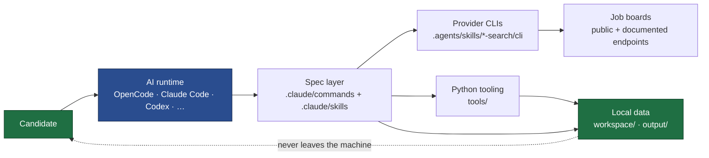

# Architecture

| Document | Purpose |
|---|---|
| [current-state.md](./current-state.md) | What exists today, verified against `78813db` |
| [target-architecture.md](./target-architecture.md) | What the system becomes, and why |
| [system-design.md](./system-design.md) | Components, module boundaries, data flows |
| [adr/](./adr/README.md) | Architecture Decision Records |

## The one-paragraph version

ApplyOS is a **local-first job-search platform** in which the *specification* is the product.
Twelve markdown workflow specs under `.claude/` define what a job search does, step by step,
including which files are read, which are written, which external tools are invoked, and which
invariants must hold. Every other AI runtime reaches those same specs through a thin pointer. A
Bun/TypeScript **engine** implements the deterministic half — fetching, robots gating, dedupe,
gates, scoring, document assembly — in code so that it is testable and reproducible. A set of
**provider CLIs** reaches the job boards. Python **tooling** handles state and document
verification. The candidate's personal data never leaves the machine.

## Reading order

1. **New to the project?** Start with [current-state.md](./current-state.md).
2. **Deciding what to build?** Read [target-architecture.md](./target-architecture.md).
3. **About to move code?** Read [system-design.md](./system-design.md#3-module-boundaries).
4. **Making an architectural choice?** Check [adr/](./adr/README.md) first, then write a new ADR.

## Architecture in one diagram

## The three invariants everything else obeys

1. **One source of truth per concern.** Workflow content lives in `.claude/` and nowhere else.
   A second copy is a defect, and CI fails the PR that introduces one.
2. **Local-first is a hard constraint.** Personal data never leaves the machine — enforced by
   gitignore rules and `tools/security_guards.py`, not by good intentions.
3. **Determinism where it is possible, judgment where it is necessary.** Parsing, gating,
   deduping, and verifying are code. Assessing fit, drafting, and reviewing are the agent's.

## Architectural health at a glance

| Signal | Reading |
|---|---|
| Two independent implementations of scrape/rank/apply | 🔴 Highest risk — ADR-0007, Phase 2 |
| Five boards implemented twice with different contracts | 🔴 ADR-0008, Phase 4 |
| No evaluation harness | 🟠 Phase 9 |
| No link check in CI | 🟠 Phase 1 |
| Tracker CSV is the highest-fanout contract in the repo | 🟠 Phase 7 hardens it |
| Spec files are the single source of truth and CI-enforced | 🟢 Strong |
| Privacy enforcement is automated and CI-guarded | 🟢 Strong |
| LaTeX document pipeline is version-pinned and dual-TeX-tested | 🟢 Strong |
