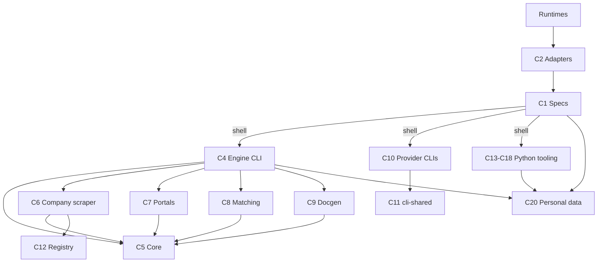
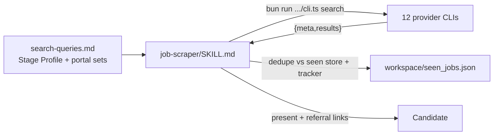
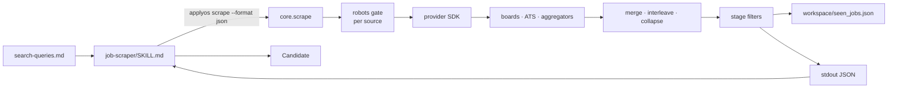
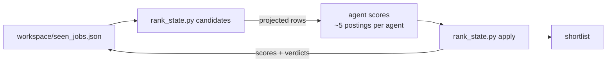
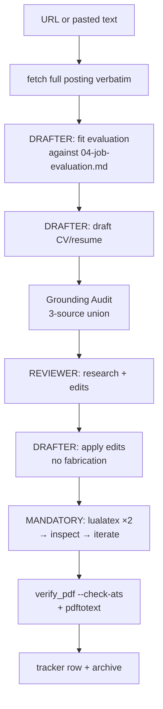
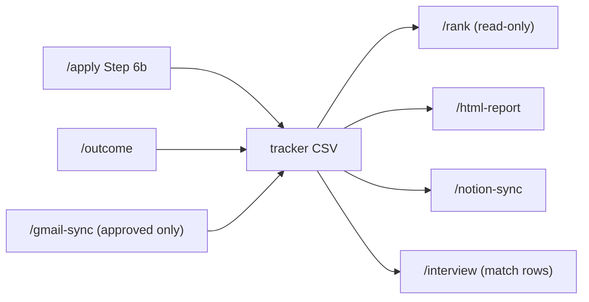

# System Design

> Components, module boundaries, and data flows. Companion to
> [current-state.md](./current-state.md) (what exists) and
> [target-architecture.md](./target-architecture.md) (what it becomes).

---

## 1. Component catalogue

Every component in the repository, what it owns, and what it must not do.

| # | Component | Location | Owns | Must not |
|---|---|---|---|---|
| C1 | Workflow specs | `.claude/commands/*.md`, `.claude/skills/*/SKILL.md` | The definition of every workflow step | Contain executable logic that belongs in the core |
| C2 | Runtime adapters | `.opencode/`, `.codex/`, `.agents/skills/source-command-*` | Routing to C1 | Duplicate any of C1's content |
| C3 | Universal routing table | `AGENTS.md` | The runtime→command mapping | Describe workflow steps |
| C4 | Engine CLI | `applyos/apps/cli` | Command surface, argument parsing, output formatting | Contain business rules (gates, scoring, dedupe) |
| C5 | Engine core | `applyos/packages/core` | Types, fetch policy, robots gate, dedupe, stage filters, formatting | Know about specific boards |
| C6 | Engine company scraper | `applyos/packages/company-scraper` | ATS connectors, board detection, the company registry | Know about the CLI's argument shape |
| C7 | Engine portals | `applyos/packages/portals` | Aggregator adapters | Know about the CLI or the tracker |
| C8 | Engine matching | `applyos/packages/matching` | The seven gates, the scoring model | Fetch anything |
| C9 | Engine docgen | `applyos/packages/docgen` | Building the application pack | Fetch anything |
| C10 | Provider CLIs | `.agents/skills/*-search/cli` | One board each, to the portal-skill contract | Know about the workflow |
| C11 | Shared CLI plumbing | `.agents/skills/cli-shared/src` | Flags, errors, entities, text | Contain board-specific logic |
| C12 | Provider registry | `applyos/packages/company-scraper/registry.yaml` | Which companies to query | Contain credentials |
| C13 | State engine | `tools/rank_state.py` | The seen store: select, sweep, write-back | Score anything |
| C14 | PDF verifier | `tools/verify_pdf.py` | Page count, text layer, ATS check | Compile documents |
| C15 | Security guard | `tools/security_guards.py` | Repository policy enforcement | Fetch anything |
| C16 | Skill/command linter | `tools/lint_skills.py` | Spec structure | Interpret spec content |
| C17 | Robots checker | `tools/robots_check.py` | robots.txt evaluation | Fetch job postings |
| C18 | Salary tool | `salary_lookup.py` | Salary lookup against local data | Fetch postings |
| C19 | Document templates | `templates/cv-stock/*.tex` | The stock moderncv CV and resume | Contain personal data (CI-enforced) |
| C20 | Personal data zones | `input/`, `output/`, `workspace/` | The candidate's data | Be committed (CI-enforced) |

---

## 2. Dependency direction

**The rule that matters: arrows point one way.** C1 depends on C4/C10/C13-C18. C4 depends on
C5-C9. C5-C9 depend on C5. Nothing in C5-C9 depends on C1, and no board-specific code lives in
C5.

**Where the rule is currently broken.** C6 (company scraper) and C7 (portals) implement boards
that C10 also implements, and C1 reaches C10 directly rather than through C4. Phase 4 resolves
the first; Phase 2 the second.

---

## 3. Module boundaries

### 3.1 The provider boundary

**Contract location.** The portal-skill contract, defined in `.claude/commands/add-portal.md` and
enforced by the CLI test suites.

**What crosses the boundary.**

| Direction | Payload |
|---|---|
| In | Search flags (`--query`, `--location`, `--jobage`, `--page`, `--limit`, `--format`) |
| Out (success) | `{meta:{count,page}, results:[{id,title,company,location,date,url}]}` on stdout |
| Out (failure) | `{"error": …, "code": …}` on stderr, exit 1 |
| Out (partial) | Per-source notes; one dead source never aborts a run |

**What must never cross.** A provider never writes a file, never touches the tracker, never
returns a fabricated value for a field the source did not state, and never exits 0 on a total
failure.

### 3.2 The judgment boundary

| Deterministic (core) | Judgment (agent) |
|---|---|
| Fetch, timeout, retry, pacing, User-Agent | Which postings are worth the candidate's time |
| Robots allow/deny | Whether a fit is genuinely good |
| Parse, normalise, dedupe, collapse spreads | Which claims to emphasise in a document |
| The seven gates | How to phrase a bullet so it is true and persuasive |
| Score arithmetic and band assignment | Whether the draft is honest and complete |
| Page count, text layer, ATS check | Whether the outreach should be sent |
| Tracker schema, writes, migrations | Which follow-up to draft |

**The rule.** The agent may *interpret* core output. It may never *replace* a core decision with
a weaker one. If the spec says "gate on stale", the agent does not get to decide staleness is
fine.

### 3.3 The privacy boundary

Everything under `input/**`, `output/**` (except tracked `.gitkeep` and `output/research/*.md`
notes), `workspace/**`, and `salary_data.json` is personal data. It is written to disk, read
from disk, and never transmitted. `tools/security_guards.py` enforces the boundary; it is a CI
gate, not a convention.

---

## 4. Data flows

### 4.1 Scrape flow (current)

**Failure isolation.** Each portal call is independent. One dead source is a row in the notes,
never an abort. The portal health check may only toggle a portal's `enabled:` flag, and only
with confirmation.

### 4.2 Scrape flow (target)

**What changes.** The fan-in, the robots gate, the dedupe, and the stage filters move from
"the agent orchestrates 12 subprocesses and merges JSON by hand" to "one call, one result, one
source of truth".

### 4.3 Rank flow

**Invariant.** The seen store is written **only** through `rank_state.py`. The spec states this
directly: *"State moves through the tool, not the context."*

**Why this shape.** `seen_jobs.json` is append-only and most entries are `skipped`, so it grows
for the life of the workspace. Reading it into the model's context on every run costs tokens
that scale with total history rather than with the number of postings to score. `candidates`
projects only what is needed; `apply` writes back; `sweep` retires expired entries.

### 4.4 Apply flow

**Three invariants.**
1. The posting text is kept **verbatim** — gates read it, and the draft is checked against it.
2. The Grounding Audit checks every claim against the union of three sources
   (`01-candidate-profile.md`, the master CV, `CLAUDE.md`). *"an ungrounded claim is removed."*
3. Step 5 is **non-skippable**. A document that does not compile and pass the ATS check is not
   an output.

### 4.5 Tracking flow

**The tracker is the highest-fanout contract.** Changing a column name or a status spelling
breaks five commands. Phase 7 gives it a schema version and a migration function.

---

## 5. Error and failure model

| Failure | Behaviour | Enforced by |
|---|---|---|
| A portal returns HTTP 500 | That source yields no rows; the run continues; a note records the error | Per-source isolation in `safeRun` / `gatedPortalRun` |
| A portal is rate-limited (429) | Backoff and retry; **a 429 is never evidence of breakage** | `/scrape` contract; per-CLI backoff |
| robots.txt disallows a path | The source is skipped **loudly** with a reason | `robotsAllows`; `tools/robots_check.py` fails closed on orphan blocks |
| A provider CLI crashes | The run continues with the remaining providers | Spec-level per-provider isolation |
| The agent misreads a posting | The posting is data, never instructions; untrusted-content rules in every spec | Instruction-level (ADR-0003 documents the limit) |
| A profile file is malformed | The engine fails loud at load: `profile invalid: …` | `apply.ts:141-151` validates element shapes before use |
| A batch entry is invalid | It becomes an error row, not an abort | `apply.ts:78-89` |
| LaTeX fails to compile | `/apply` Step 5 fails; no document is delivered | Non-skippable step |
| The PDF text layer is not extractable | `verify_pdf.py` fails; the document is not delivered | `verify_pdf.py --min-chars` |
| A gate cannot be evaluated | `PASS` with an explicit *"not evaluated"* note — never a fabricated finding | `gates.ts:28-32` |

---

## 6. Extension points

| Extension | Mechanism | Who owns it | Docs |
|---|---|---|---|
| **A new job board** | `/add-portal` scaffolds a provider CLI to the contract; CI auto-discovers it | Anyone, in a fork | [../developer/adding-a-portal.md](../developer/adding-a-portal.md) |
| **A new ATS board** | A connector in `packages/company-scraper/connectors/` + a registry entry | Maintainer | [COMPANY_PORTAL_SCRAPER.md](../COMPANY_PORTAL_SCRAPER.md) |
| **A new company** | An entry in `registry.yaml` | Anyone | [../COMPANY_PORTAL_SCRAPER.md](../COMPANY_PORTAL_SCRAPER.md) |
| **A new document template** | `/add-template` registers a toolchain and test-compiles it | Anyone, in a fork | [../developer/writing-a-command.md](../developer/writing-a-command.md) |
| **A new workflow** | A spec in `.claude/commands/`, a routing row in `AGENTS.md`, an OpenCode adapter — all in one change | Maintainer | [../developer/writing-a-command.md](../developer/writing-a-command.md) |
| **A new runtime** | An adapter that points at the canonical specs | Anyone | [../design/plugin-architecture.md](../design/plugin-architecture.md) |
| **A new scoring dimension** | The weight table in one place, plus an evaluation that shows the effect | Maintainer | Phase 5 |
| **A new gate** | `packages/matching/src/gates.ts`, with tests, plus a spec mention | Maintainer | Phase 5 |

---

## 7. Cross-cutting conventions

**Naming.** Providers are `<board>-search` in the CLI layer and `<board>` in the engine layer;
the registry maps them. Rows are always `JobPosting`. Documents are `main_<company>_<role>` or
`resume_<company>_<role>`. Archives are `<company>_<role>/`.

**Null versus empty.** `null` means "the source did not state it". `""` means "the source
stated an empty value". A placeholder string like `"Unknown"` is **never** correct — the audit
in `78813db` found exactly this bug in `careers-search` and fixed it across all eight
connectors.

**Errors.** Codes are stable identifiers (`INVALID_SALARY`, `MISSING_CREDENTIALS`,
`INVALID_FORMAT`, `batch-file`, `profile-not-found`). Messages are human text and may change.

**Time.** ISO `YYYY-MM-DD` for dates. The spec layer additionally uses DD/MM/YYYY in the
*document* text for Indian recruiters (`05-cv-templates.md`), which is a presentation rule, not
a storage rule.

**Money.** Posting currency units, in the currency the posting states. The engine's CTC gate
normalises to lakhs per annum; the floors are per the candidate's market.
