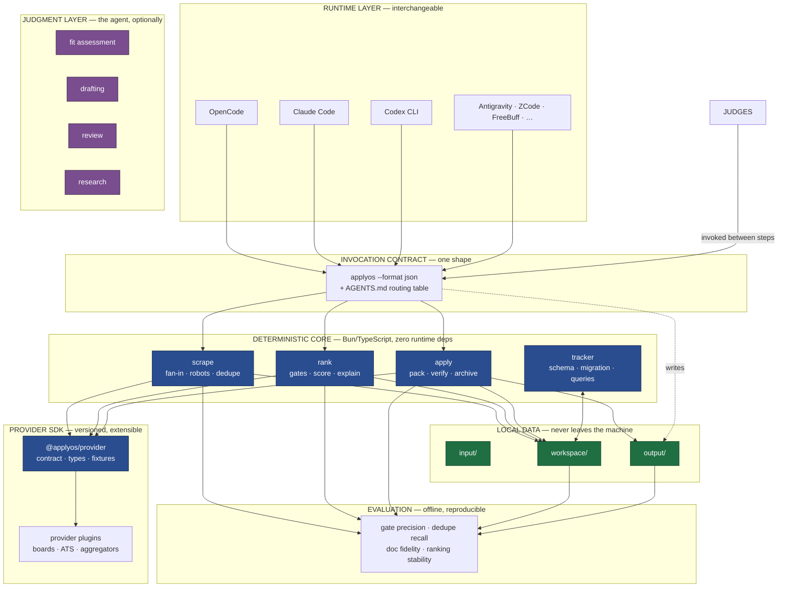

# Target Architecture

> **Status:** `PROPOSED`. This document describes the intended end state. Nothing here is
> shipped unless [IMPLEMENTATION_STATUS.md](../IMPLEMENTATION_STATUS.md) says `IMPLEMENTED`.
> **Approval gate:** ADR-0007 must be accepted before Phase 2 begins.

---

## 1. The goal

> **One deterministic core, driven by any runtime, extended by anyone, measuring itself.**

Five clauses, each of which maps to a concrete architectural change:

| Clause | Today | Target |
|---|---|---|
| **One deterministic core** | Two independent implementations of scrape/rank/apply | One core; the spec layer delegates to it |
| **Driven by any runtime** | 13 entry points, 3 adapter styles, a routing table | A single invocation contract every runtime can satisfy |
| **Extended by anyone** | 12 provider CLIs with a documented contract, but no SDK | A versioned provider SDK with a plugin lifecycle |
| **Measured itself** | No evaluation harness | Reproducible offline evaluations for gates, dedupe, and documents |
| **Privacy preserved** | Local-first, enforced in CI | Unchanged — plus a documented threat model and data inventory |

---

## 2. Target topology



---

## 3. The seven architectural changes

### 3.1 The core becomes reachable

**Change.** Every spec step that performs a deterministic operation calls the core:

| Spec step | Today | Target |
|---|---|---|
| `/scrape` Step 1b | `bun run .agents/skills/<p>/cli/src/cli.ts search` per portal, orchestrated by the agent | `applyos scrape --format json` — the core fans out, the agent presents |
| `/scrape` Step 4 | agent writes `seen_jobs.json` | `applyos scrape --write-state` |
| `/rank` Steps 1, 4 | `python tools/rank_state.py` | `applyos rank state candidates` / `applyos rank state apply` (the Python tool becomes a thin wrapper or is retired) |
| `/apply` Steps 1, 2 | agent reasons over the posting | `applyos apply --format json` produces the pack; the agent reviews it |
| `/apply` Step 5d | `python tools/verify_pdf.py` | unchanged — PDF verification stays in Python where `pypdf`/Poppler live |

**Rule.** The agent never hand-writes a JSON state file, never hand-implements a gate, and never
hand-implements dedupe. If a step is expressible as code, it is code.

**Why this matters.** The engine already has 168 passing tests covering exactly these
operations. Today those tests protect code that no workflow reaches.

### 3.2 The provider SDK becomes the single extension point

**Change.** One versioned package defines the provider contract. Both consumers use it:

- The `applyos` engine calls SDK providers directly.
- The `/scrape` spec calls either `applyos scrape` (preferred) or a provider CLI
  (backwards-compatible path during migration).

**Contract (draft).**

```ts
interface Provider {
  readonly id: string;              // "naukri", "greenhouse", …
  readonly version: string;         // semver of the provider implementation
  readonly kind: "board" | "ats" | "aggregator";
  search(req: SearchRequest): Promise<SearchPage>;
  detail(ref: string): Promise<JobPosting & { description: string }>;
}
```

Every provider returns the shared `JobPosting` row, with `null` for anything the source does not
state. Errors are typed, not strings. See [../design/provider-sdk.md](../design/provider-sdk.md).

### 3.3 One scoring model, explainable

**Change.** A single versioned scoring model, with the weights in one place and the output
carrying its own explanation.

```ts
interface ScoreExplanation {
  dimensions: { name: string; weight: number; raw: number; contribution: number; evidence: string }[];
  band: "strong" | "good" | "moderate" | "weak" | "poor";
  gates: GateResult[];
  modelVersion: string;
}
```

The engine's deterministic factors and the spec layer's richer dimensions are reconciled:
- **Deterministic** signals (skill overlap, title tokens, freshness, location, date) are computed
  by the core.
- **Judgment** signals (behavioural fit, career trajectory) remain the agent's, and are passed
  *into* the core as an explicit, versioned input rather than being re-derived.

**Result.** `/rank` gets a reproducible base score; the agent adds judgment on top; the
explanation shows exactly which dimension moved the number.

### 3.4 The tracker gets a schema and a migration path

**Change.** The 14-column CSV becomes a versioned contract with:
- a documented column list (already present, but informal),
- a named schema version,
- a migration function for the legacy `cover_letter_file` column and the legacy space-form
  statuses,
- typed read/write helpers in the core,
- the archive directory naming rule (`<company>_<role>/`) defined in one place.

The CSV stays CSV — it is human-inspectable, git-diffable, and tool-agnostic. It does **not**
become SQLite (see [../design/public-api.md](../design/public-api.md) for the reasoning).

### 3.5 The document engine keeps LaTeX and gains a machine-readable sibling

**Change.** The LaTeX pipeline stays exactly as it is. Alongside it, the core emits a
**Document Manifest** — a JSON sidecar describing every claim in the produced document and its
source.

```json
{
  "documentVersion": 1,
  "profile": "01-candidate-profile.md",
  "claims": [
    { "text": "Reduced p99 latency by 40%", "source": "01-candidate-profile.md#achievements", "grounded": true }
  ],
  "ungrounded": []
}
```

This turns the spec layer's "Grounding Audit" from a model instruction into a **checkable
artifact**, and gives the evaluation harness something to measure.

### 3.6 Evaluation becomes a first-class citizen

**Change.** A committed evaluation corpus with a runner:

```
applyos eval            # run all offline evaluations
applyos eval gates      # gate precision / recall on a labelled corpus
applyos eval dedupe     # dedupe precision / recall
applyos eval documents  # document fidelity against the manifest
```

Every evaluation is **offline** (no network, no model calls) so results are reproducible and
CI can gate on them. See [../engineering/evaluation.md](../engineering/evaluation.md).

### 3.7 A single invocation contract for every runtime

**Change.** Every runtime reaches ApplyOS the same way:

```
applyos <command> --format json
```

`AGENTS.md` becomes the universal adapter; `.opencode/command/*.md` stays a thin pointer to it
or to the canonical spec; `.codex/agents/*.toml` is reduced to one entry point.

Runtimes without a shell (hypothetical) get the same JSON over stdio.

---

## 4. What does **not** change

This matters as much as what does.

| Kept | Why |
|---|---|
| **Markdown specs as the implementation** | ADR-0001. It is the project's most distinctive and most CI-protected property |
| **Thin-pointer adapters** | ADR-0002. The parity test already enforces it |
| **Local-first privacy** | ADR-0003. Non-negotiable |
| **The LaTeX/moderncv pipeline** | ADR-0005. A genuine differentiator versus HTML+Playwright |
| **The portal-skill contract** | ADR-0006. Extended, not replaced — the CLI form stays for external contributors |
| **Zero runtime dependencies for provider CLIs** | Keeps a CLI usable in any environment with `bun` and nothing else |
| **The tracker CSV** | Human-inspectable, diffable, tool-agnostic |
| **The 13 workflows** | The lifecycle is feature-complete; new commands face a high bar (`CONTRIBUTING.md`) |
| **The permission allowlist model** | It works, and CI keeps it honest |
| **The `applyos` CLI name and shape** | `scrape`, `rank`, `apply` — already good |

---

## 5. Migration path

The convergence is **additive before it is subtractive**. Nothing is deleted until its
replacement is proven.

```mermaid
flowchart LR
  A["Today<br/>spec does everything"] -->|"Phase 1"| B["Baseline<br/>green clone, one script"]
  B -->|"Phase 2"| C["Shadow<br/>engine runs alongside, output compared"]
  C -->|"Phase 3-5"| D["Delegation<br/>spec calls core for deterministic steps"]
  D -->|"Phase 6-9"| E["Enrichment<br/>manifest · evaluations · SDK"]
  E -->|"Phase 10-12"| F["Product<br/>CLI · TUI · distribution"]
  F --> G["Retire duplicates<br/>only after parity is proven"]

  classDef ok fill:#1f6f43,stroke:#0d3d25,color:#fff
  classDef next fill:#7a4d8f,stroke:#3d2647,color:#fff
  class A ok
  class B ok
  class C next
```



**The safety rule.** In Phase 2 the engine runs in **shadow mode** — it executes the same
operation as the spec and its output is compared, not consumed. Only after the comparison
passes does a spec step switch from "agent does it" to "agent calls the core". The
implementation is written to the [phase plan](../phases/phase-02-architecture-convergence.md)
with an explicit rollback for every step.

---

## 6. Success criteria

The target architecture is reached when **all** of the following are true. These are
checkable statements, not aspirations.

| # | Criterion | How it is checked |
|---|---|---|
| 1 | A fresh clone runs the full verification suite in one command | Phase 1 bootstrap script; CI |
| 2 | No spec step re-implements a gate, a dedupe rule, or a fetch policy | Code review against [../CHANGE_IMPACT_MATRIX.md](../CHANGE_IMPACT_MATRIX.md) |
| 3 | Each board has exactly one implementation | Provider registry has one entry per board; Phase 4 acceptance |
| 4 | One scoring model, one weight table, one band set | `applyos eval ranking` reports a `modelVersion` |
| 5 | Every document carries a machine-checkable claim manifest | `applyos eval documents` reports zero ungrounded claims |
| 6 | The tracker has a named schema version and a migration function | `applyos tracker --version` prints it |
| 7 | Offline evaluations run in CI and gate the merge | A CI job runs `applyos eval` and fails on regression |
| 8 | Every runtime reaches ApplyOS through one invocation shape | `AGENTS.md` routing table plus the parity test |
| 9 | No personal data leaves the machine, enforced by CI | `tools/security_guards.py` stays green |
| 10 | A new provider can be added without touching the core | A worked example in [../developer/adding-a-portal.md](../developer/adding-a-portal.md) |

---

## 7. Explicit non-goals

Recorded so future contributors do not read absence as permission.

| Not doing | Why |
|---|---|
| A hosted service, accounts, or a sync backend | Breaks ADR-0003 |
| Telemetry or usage analytics | Breaks ADR-0003; also no metric in this repo justifies it |
| Multi-language document generation | A deliberate v1 exclusion (`search-queries.md`, "Language Filter") |
| A GUI or web application | The candidate's machine is the trust boundary; a browser UI weakens it |
| Multi-tenant provider hosting | Same |
| Replacing LaTeX with HTML+Playwright | Would trade ATS fidelity for a dependency |
| An npm-published package before Phase 12 | [Q6](../OPEN_QUESTIONS.md#q6--should-applyos-be-published-to-npm--non-blocking-for-phases-19-relevant-to-phase-12) is unresolved |
| A plugin marketplace with third-party code execution | A supply-chain surface the threat model does not currently justify |
