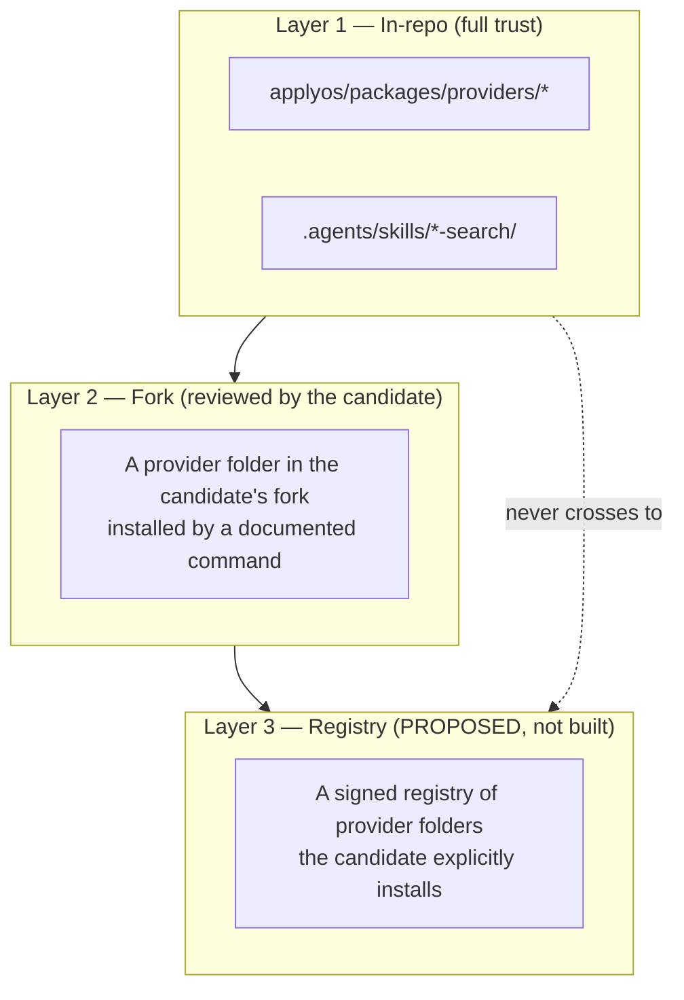
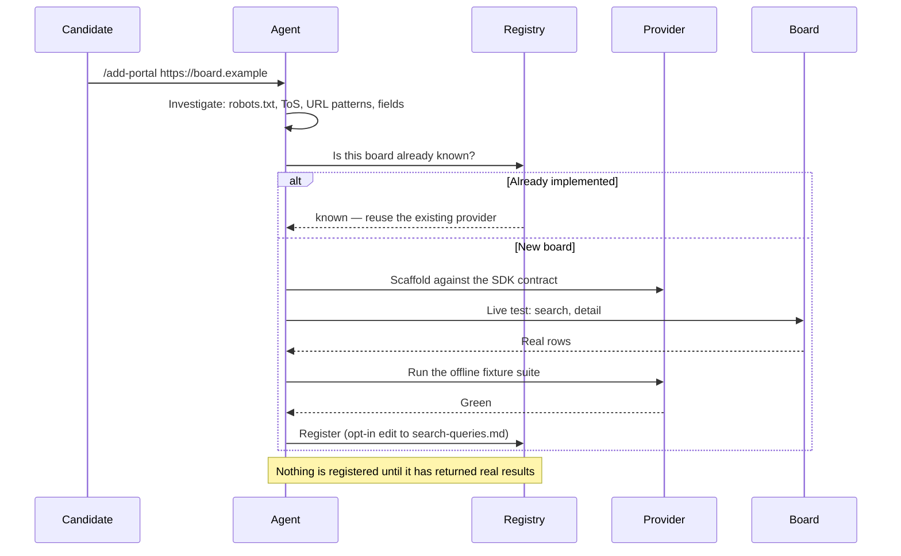

# Plugin Architecture

> **Status:** `PROPOSED`. Phase 4 introduces the provider SDK; this document defines how the
> SDK is extended beyond the in-repo set and what the trust model permits.

---

## 1. The trust problem

ApplyOS's central promise is that personal data never leaves the machine (ADR-0003). The moment
third-party code can run, that promise needs a scope.

| Extension kind | Runs with | Can read personal data? | Network? | Trust posture |
|---|---|---|---|---|
| **In-repo provider** | The agent's shell | Yes (it is the agent's own command) | Yes, to the board | Full trust — reviewed in the repo |
| **Third-party provider in a fork** | The contributor's machine | Yes | Yes | The contributor's responsibility; the fork owner chose it |
| **Third-party provider installed at runtime** | The candidate's machine | Yes | Yes | **Unacceptable** as designed today |
| **Hosted provider service** | A vendor's machine | Potentially | Yes | Breaks ADR-0003 |

The current design already has the right instinct: `/add-portal` scaffolds a provider into the
user's **own fork**, and `CONTRIBUTING.md` states that market-specific skills *"belong in your own
private checkout"*. A provider is therefore code the candidate reviewed and installed
deliberately, on their own machine — the same trust model as any other local CLI they run.

**The SDK must not weaken this.** It should make the trusted path *easier*, not open a new one.

---

## 2. Three extension layers, by trust

### Layer 1 — In-repo providers

The current twelve. Fully reviewed, CI-tested, typechecked, and linted by the matrix.

### Layer 2 — Fork providers

A candidate (or a contributor working in a fork) adds a board with `/add-portal`. The provider
lives in `.agents/skills/<board>-search/` in their checkout. It is ordinary code in their
repository, subject to their own review. **This is the primary extension path and it is
already implemented.**

### Layer 3 — A provider registry

`PROPOSED`, and deliberately deferred. A registry would let a candidate install a provider
written by a stranger with one command. That command would:

- run third-party code with the candidate's file access,
- need a trust story (signing, checksums, provenance),
- need a supply-chain story (dependency confusion, typosquatting, malicious update),
- and would materially widen the blast radius of ADR-0003.

**Recommendation.** Do not build Layer 3 until there is evidence that Layer 2 is insufficient and
that a trust mechanism has been designed and reviewed. It is recorded in
[../OPEN_QUESTIONS.md](../OPEN_QUESTIONS.md) and Phase 12 as an explicit non-goal.

---

## 3. What the SDK makes pluggable

### 3.1 Pluggable today (after Phase 4)

| Extension point | Interface | Surface | Owner |
|---|---|---|---|
| Job board | `Provider` | TypeScript | Anyone, in a fork |
| ATS board | `Provider` (kind: `"ats"`) | TypeScript | Maintainer for in-repo; fork for the rest |
| Company registry entry | YAML | Data | Anyone, in a fork |
| Document toolchain | `/add-template` | LaTeX/Typst/other | Anyone, in a fork |
| Scoring dimension | Weight table | Data + code | Maintainer |
| Gate | `GateResult` producer | Code | Maintainer |

### 3.2 Not pluggable, by decision

| Not extensible | Why |
|---|---|
| The tracker schema | It is the highest-fanout contract in the repo; a fork that changed it would fork the whole system |
| The privacy boundary | Changing it changes the product |
| The document page budget | It is the ATS guarantee |
| The provider error envelope | Every consumer depends on it |
| The fetch policy | It is the politeness guarantee to third-party boards |

These are **constants, not extensions**. A fork may change them; the SDK will not expose them as
configuration.

---

## 4. The provider lifecycle

**The registration gate is the contract.** `/add-portal` Step 4 is mandatory:
*"Never register a portal skill that has not returned real results."* A provider that has never
fetched a real row is not a provider.

---

## 5. Versioning

| Artefact | Versioned how | Compatibility rule |
|---|---|---|
| `Provider` interface | Semver on the SDK package | A breaking change is a major bump; providers pin a range |
| Provider implementation | `Provider.version` (semver, per implementation) | Reported in run notes so a behaviour change is attributable |
| Board content | Not versioned — boards change without notice | Providers must fail loudly on a shape change, not silently return fewer rows |
| Portal-skill JSON envelope | Stable since ADR-0006 | Breaking changes require a contract version field |
| Tracker schema | `IMPLEMENTED` — Phase 7; `contract.ts` + `tracker.ts`, `workspace/.tracker_version`, `applyos tracker migrate` | Migrations are dry-run by default, applied with `--write` |

**The board-content rule matters most.** A provider will eventually break because the board
changed, not because the provider changed. The required behaviour is to throw
`ProviderError { code: "parse" }`, never to return an empty page that reads as "no jobs were
found" — the exact bug class the audit found in three separate providers.

---

## 6. Compatibility policy for the SDK

Because a provider may live in a fork that was written against an older SDK:

1. **Additive changes only within a major version.** New optional fields on `Provider` are
   additive. New required fields are not.
2. **`SearchRequest` and `SearchPage` fields are optional** except where the board genuinely
   requires them. A provider must tolerate an absent field.
3. **`ProviderError` codes are a set, not a closed enum.** New codes may be added; consumers must
   handle unknown codes gracefully (treat as non-fatal and record the code).
4. **A provider must never depend on a provider's internals.** Only the SDK's public types.

---

## 7. Testing a plugin

| Test kind | Where | Network |
|---|---|---|
| Contract conformance | `.agents/skills/<board>/cli/tests/` | No — fixtures |
| Live smoke | Local, on demand | Yes — **never in CI** |
| Parity against a previous implementation | Phase 4 migration | No — both run on fixtures |

The live-smoke rule is enforced: seven suites previously spawned the real CLI through
`Bun.spawn` in CI, contradicting the workflow header's promise. They are now gated behind
`APPLYOS_LIVE_TESTS`.

---

## 8. Anti-goals

| Anti-goal | Reason |
|---|---|
| A runtime plugin host that executes third-party code automatically | Unreviewed code with the candidate's file access |
| A hosted provider proxy | Breaks ADR-0003 |
| A marketplace with ratings and downloads | A supply-chain surface with no trust model |
| Loading providers dynamically from the network | Same |
| Letting a provider write files other than its own | Breaks the "everything the agent writes is inspectable" property |
| Letting a provider change the fetch policy | Breaks the politeness guarantee |
