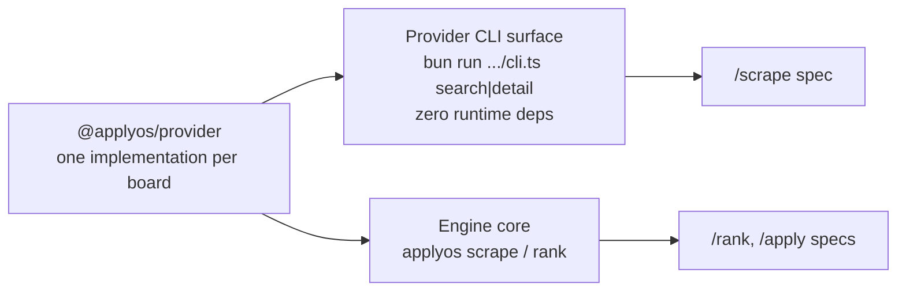

# Provider SDK

> **Status:** `PROPOSED`. The **CLI** contract it generalises is `IMPLEMENTED`
> (ADR-0006, defined in `.claude/commands/add-portal.md`). This document defines the
> TypeScript surface that Phase 4 builds.

---

## 1. Why an SDK

Today, reaching a board means one of two things: a provider CLI (12 of them, text contract,
zero dependencies) or an engine adapter (6 of them, `JobPosting` contract). Five boards have
both, with two parsers and two test suites each.

The SDK gives every board **one implementation** behind **one typed interface**, exposed
through two surfaces:



The CLI surface is preserved deliberately: it is the contribution path that lets an external
contributor add a board by dropping a folder, with no monorepo membership required.

---

## 2. The provider interface

```ts
/** Every provider implements this. */
export interface Provider {
  /** Stable identifier, e.g. "naukri", "greenhouse". Matches the registry key. */
  readonly id: string;
  /** Semver of this provider implementation, not of the board. */
  readonly version: string;
  /** What kind of surface this is. */
  readonly kind: "board" | "ats" | "aggregator";
  /** Human-readable name for notes and reports. */
  readonly displayName: string;
  /** Whether this provider needs a credential to function. */
  readonly requiresCredential?: { readonly envVar: string; readonly service: string };

  /** List postings. */
  search(req: SearchRequest): Promise<SearchPage>;
  /** Fetch one posting in full, including its description text. */
  detail(ref: string): Promise<PostingDetail>;
}
```

### 2.1 Request

```ts
export interface SearchRequest {
  readonly query?: string;
  readonly location?: string;
  /** Maximum age in days. 0 = no filter. */
  readonly jobAgeDays?: number;
  /** 1-indexed. */
  readonly page?: number;
  /** 0 = no cap. */
  readonly limit?: number;
  /** Stage hint; a provider MAY use it to pick a corpus (e.g. internships only). */
  readonly stage?: CandidateStage;
}
```

### 2.2 Response

```ts
export interface SearchPage {
  readonly rows: JobPosting[];
  readonly page: number;
  /** True when the source had more rows than were returned. */
  readonly truncated: boolean;
  /** Non-fatal notes: retries taken, a partial parse, a soft-200 response. */
  readonly notes?: string[];
}
```

`JobPosting` is the shared row type from `applyos/packages/core/src/types.ts`. It is the **same
type** in both layers after Phase 4 — the SDK becomes its home.

### 2.3 Detail

```ts
export interface PostingDetail extends JobPosting {
  /** The full posting text, verbatim. Never summarised. */
  readonly description: string;
  /** Where the description came from: a connector, a paste, a search index. */
  readonly source: "connector" | "pasted" | "index";
}
```

> **The description must be verbatim.** The gates read it (`language`, `batch`, `stipend`,
> `ctc`, `bond`), and the drafter is checked against it. A summarised description would make
> the gates unsound and the Grounding Audit unverifiable.

---

## 3. Errors

```ts
export type ProviderErrorCode =
  | "network"            // connection refused, DNS, TLS
  | "timeout"
  | "http"               // non-2xx
  | "rate-limited"       // 429
  | "robots-disallowed"
  | "parse"              // the page changed shape
  | "not-found"          // the posting is gone
  | "credentials"        // missing or invalid credential
  | "unsupported";       // the board needs something we do not have

export class ProviderError extends Error {
  readonly code: ProviderErrorCode;
  readonly retryable: boolean;
  readonly cause?: unknown;
}
```

**Rules.**

1. A provider throws `ProviderError` for a fatal condition and returns a `SearchPage` with zero
   rows for a legitimate empty result. The distinction matters: an empty board is not an error.
2. `retryable` is explicit. The core decides the retry policy; the provider does not implement
   its own backoff loop. This is a deliberate change from the CLI layer, where
   `fetchWithBackoff` semantics differ per CLI and are pinned by tests — see
   [../architecture/adr/0006-portal-skill-contract.md](../architecture/adr/0006-portal-skill-contract.md).
3. `robots-disallowed` is never retryable and never silently downgraded. The scrape run records
   it in `SearchMeta.notes`.

---

## 4. The null discipline

This is the SDK's most important rule, and it exists because of a real bug class.

| The source… | Must yield | Never |
|---|---|---|
| states no location | `location: null` | `""`, `"Unknown"`, `"-"`, a guessed city |
| states no date | `postedDate: null` | `"1970-01-01"`, today's date, an inferred date |
| omits a field | the field is `null` | the field is absent from the object |
| returns a truncated description | `description` truncated, with a note | a silently complete-looking description |
| cannot find the posting | throw `not-found` | a row with an invented title |

**The `careers-search` em-dash bug** — substituting `"—"` for an unstated location across all
eight connectors — is the canonical example. It was found and fixed in `78813db`. A test now
pins it.

---

## 5. Politeness

The SDK inherits the engine's outbound policy (`packages/core/src/fetch.ts`):

| Setting | Value | Source |
|---|---|---|
| Timeout | 20 000 ms | `DEFAULT_TIMEOUT_MS` |
| Retries | exactly 1 | `fetch.ts:16` |
| Inter-host pacing | 300 ms | `DEFAULT_PACING_MS` |
| User-Agent | `applyos/0.1 (personal use)` | `UA` |

A provider **must not**:
- exceed the page cap without recording `truncated`,
- run requests concurrently against the same host,
- retry more than the core's policy allows,
- send a request whose robots.txt disallows the path,
- use a User-Agent that impersonates a browser in order to bypass a block.

> **Note on the last point.** The audit recorded a "Chrome-UA convention" as a regression, not an
> improvement: a CLI sending `*-cli/1.0` identifies itself honestly. The engine uses
> `applyos/0.1 (personal use)`. Providers should identify themselves too.

---

## 6. The CLI surface

A provider CLI built on the SDK keeps the exact contract from ADR-0006:

```
bun run .agents/skills/<board>-search/cli/src/cli.ts search [flags]
bun run .agents/skills/<board>-search/cli/src/cli.ts detail <id|url> [--format ...]
```

| Aspect | Value |
|---|---|
| Search flags | `--query`/`-q`, `--location`/`-l`, `--jobage <days>`, `--page <n>`, `--limit <n>`, `--format json\|table\|plain` |
| Success (stdout) | `{ "meta": { "count": N, "page": P }, "results": [ … ] }` |
| Result fields | `id`, `title`, `company`, `location`, `date`, `url` — `null` when unstated |
| Failure (stderr) | `{ "error": "…", "code": "…" }`, exit **1** |
| Credentials | `<SERVICE>_API_TOKEN` env var only |
| Runtime dependencies | **zero** — the SDK is imported by relative path, like `cli-shared` today |

### 6.1 Why relative paths, not a published package

`cli-shared` already establishes the precedent: *"Imported via relative paths; never a published
package."* It keeps a contribution to exactly one folder with no install step and no version
negotiation. Phase 4 preserves that. Publishing the SDK for external use is Phase 12's question
([Q6](../OPEN_QUESTIONS.md#q6--should-applyos-be-published-to-npm--non-blocking-for-phases-19-relevant-to-phase-12)).

---

## 7. Implementing a provider

```ts
// .agents/skills/<board>-search/cli/src/provider.ts
import type { Provider, SearchRequest, SearchPage, PostingDetail } from "../../../sdk/provider";

export const myBoard: Provider = {
  id: "myboard",
  version: "1.0.0",
  kind: "board",
  displayName: "My Board",
  search: async (req: SearchRequest): Promise<SearchPage> => { /* … */ },
  detail: async (ref: string): Promise<PostingDetail> => { /* … */ },
};
```

The CLI then becomes a thin adapter over it:

```ts
// .agents/skills/<board>-search/cli/src/cli.ts
const provider = myBoard;
// parse flags → build SearchRequest → await provider.search(req) → format
```

**Required tests** (per the portal-skill contract):

1. `search` returns the exact envelope; `meta.count` matches `results.length`.
2. Missing fields are `null`, never omitted.
3. A malformed response throws `ProviderError` with `code: "parse"` — it does not return an
   empty page that reads as "no jobs".
4. A network failure throws with `code: "network"` and `retryable: true`.
5. A missing credential throws with `code: "credentials"` and exit 1.
6. An unknown flag is rejected loudly.
7. All tests run **offline** — fixtures, no network.

---

## 8. Registry

A single registry maps board → provider implementation, replacing today's split between
`applyos/packages/company-scraper/registry.yaml` (7 companies) and the implicit set of
`.agents/skills/*-search/` folders.

```yaml
# docs are the source; the machine-readable registry is generated from it
providers:
  - id: naukri
    kind: board
    implementation: .agents/skills/naukri-search
    enabled: true
    markets: [india]
  - id: greenhouse
    kind: ats
    implementation: .agents/skills/careers-search
    enabled: true
    markets: [india, global]
```

**Properties.**

- `enabled: false` is the only thing the health check may change, and only with confirmation.
- A provider that is not installed reports `skipped (not installed)` — it never fails a run.
- The registry is the single place that answers "which boards exist" — today that question has
  three answers (the skills folder, `registry.yaml`, and `search-queries.md`).

---

## 9. Migration sequence (Phase 4)

| Order | Board | Why this order |
|---|---|---|
| 1 | `remoteok` | Smallest engine adapter (36 CLI tests, 1 source file) — proves the pattern |
| 2 | `remotive` | Second-smallest |
| 3 | `weworkremotely` | RSS; shares machinery with remotive |
| 4 | `unstop` | API; has the `--salary` validation to preserve |
| 5 | `freehire` | **Remove the engine adapter first** (endpoint unverified per `PROVENANCE.md`), then implement properly |
| 6 | `arbeitnow` | Decide: CLI it, or remove it from the fan-in |
| 7 | ATS connectors | Unify `careers-search` and `packages/company-scraper` onto one connector set |

**Acceptance for each board:** the SDK implementation and the existing implementation produce
identical rows for identical queries in a fixture test; the existing CLI test suite passes
unmodified; the engine test suite passes unmodified.

---

## 10. Open design questions

| Question | Reference |
|---|---|
| Should the SDK be a published npm package? | [Q6](../OPEN_QUESTIONS.md#q6--should-applyos-be-published-to-npm--non-blocking-for-phases-19-relevant-to-phase-12) |
| Should the SDK expose a `Provider` interface only, or also a `Connector` interface for ATS boards? | Phase 4 design — ATS boards have a different lifecycle (detect → search → detail) |
| Does a provider need a "capabilities" declaration (pagination style, credential requirement, max page size)? | Phase 4 design |
| Should the CLI surface support `--page` semantics the SDK cannot express (e.g. windowing over fetched rows)? | Phase 4 design — `wellfound` and `wayup` currently do this |
