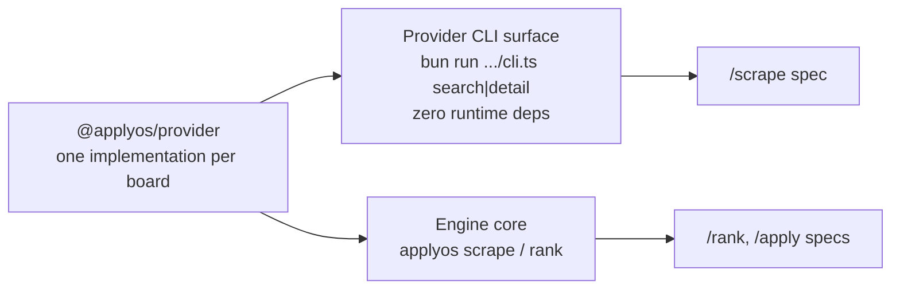

# Provider SDK

> **Status:** `IMPLEMENTED` — the SDK implements the interface below, all fourteen boards are
> migrated onto it, and the unified registry is the single board inventory. The CLI contract it
> generalises is unchanged and `IMPLEMENTED` (ADR-0006, defined in
> `.claude/commands/add-portal.md`). See [ADR-0008](../architecture/adr/0008-single-provider-implementation.md)
> for the per-board implementation record.

---

## 1. Why an SDK

Reaching a board means one of two surfaces: a provider CLI (13 folders under `.agents/skills/`,
text contract, zero runtime dependencies) or an engine adapter (6 of them, `JobPosting` contract).
After Phase 4 every board has **one** implementation in `applyos/packages/provider/src/`: six
aggregators and eight ATS boards. Five engine adapters and eight CLI boards are surfaces over it;
a parity oracle captured from each predecessor proves the surface unchanged.

The SDK gives every board **one implementation** behind **one typed interface**, exposed
through two surfaces:



The CLI surface is preserved deliberately: it is the contribution path that lets an external
contributor add a board by dropping a folder, with no monorepo membership required.

---

## 2. The provider interface

```ts
/** Every provider implements this. */
export interface Provider<R extends ProviderRow = ProviderRow> {
  /** Stable identifier, e.g. "naukri", "greenhouse". Matches the registry key. */
  readonly id: string;
  /** Semver of this provider implementation, not of the board. */
  readonly version: string;
  /** What kind of surface this is. */
  readonly kind: "board" | "ats" | "aggregator";
  /** Human-readable name for notes and reports. */
  readonly displayName: string;
  /** Whether this provider needs a credential to function. */
  readonly requiresCredential?: { readonly envVar: string; readonly service: string };
  /** The URLs a caller may fetch, for the robots gate. */
  readonly seedUrls: readonly string[];

  /** List postings. */
  search(req: SearchRequest): Promise<SearchPage<R>>;
  /** Fetch one posting in full, including its description text. */
  detail(ref: string): Promise<PostingDetail<R>>;
}
```

`Provider` is generic over its row type so a board's own row type survives to its surfaces — the
engine's `remoteok` adapter needs `RemoteOkJob`, not the widened `ProviderRow`.

### 2.0 The neutral row

```ts
/** A posting, as the board states it. */
export interface ProviderRow {
  /** The board's own id. Stable within the board. */
  readonly id: string;
  /** The board's own slug, when it has one. */
  readonly slug?: string;
  readonly title: string;
  /** The posting's employer, or null when the board states none. */
  readonly company: string | null;
  /** The posting's place, or null when the board states none. */
  readonly location: string | null;
  /** The board's own date string, exactly as it gave it. */
  readonly date: string | null;
  /** The posting's canonical URL. */
  readonly url: string;
  readonly description?: string | null;
  readonly salary?: string | null;
  readonly tags?: string[];
  readonly applyUrl?: string;
}
```

> `location`, `company` and `date` are `null` when the board states neither. `null` is
> load-bearing: it is the difference between "the board did not say" and "the board said
> nothing", and the difference between a real place and a fabricated one. "Unknown" is not a
> company. A surface that wants an empty string asks for it explicitly rather than receiving
> one by accident.

### 2.1 Request

```ts
export interface SearchRequest {
  readonly query?: string;
  readonly location?: string;
  /** A board-specific category. */
  readonly tag?: string;
  /** The minimum salary the caller will accept, in the board's currency. */
  readonly salaryMin?: number;
  /** The oldest posting the caller will accept, in days. 0 means no limit. */
  readonly jobAgeDays?: number;
  /** 1-indexed. */
  readonly page?: number;
  /** The most rows the caller wants. undefined = the default page size; 0 = no cap. */
  readonly limit?: number;
  /** Stage hint; a provider MAY use it to pick a corpus (e.g. internships only). */
  readonly stage?: CandidateStage;
  /** Board-specific parameters, passed to the board's own query. */
  readonly extra?: SearchExtras;
}
```

> **`limit` has two conventions in this repository, and the SDK's is the third.** The engine's
> `limit === 0` means "no cap"; the remoteok CLI's `--limit 0` means "use the default page size".
> The SDK's contract is `undefined` = default, `0` = no cap. Each surface translates its own
> convention before calling, so neither has to change.
>
> **`extra` carries what the common flags cannot.** A board with a richer vocabulary —
> freehire's regions, countries and seniority, say — takes those parameters here, and the
> board's `SKILL.md` documents the keys it understands.

### 2.2 Response

```ts
export interface SearchPage<R extends ProviderRow = ProviderRow> {
  readonly rows: R[];
  readonly total: number;
  readonly page: number;
  /** True when the source had more rows than this page carries. */
  readonly truncated: boolean;
  /** Non-fatal notes: retries taken, a partial parse, a soft-200 response. */
  readonly notes?: string[];
}
```

`ProviderRow` is the SDK's neutral row, not the engine's `JobPosting`. The two are documented to
differ: the CLI's result says `date`, the engine's row says `postedDate` (ISO date-only), and the
engine's row carries `portal` and `source`. The SDK owns the board's facts; each surface maps
those facts into its own shape.

### 2.3 Detail

```ts
export type PostingDetail<R extends ProviderRow = ProviderRow> = R & {
  /** The full posting text, verbatim. Never summarised. */
  readonly description?: string | null;
};
```

> **The description must be verbatim.** The gates read it (`language`, `batch`, `stipend`,
> `ctc`, `bond`), and the drafter is checked against it. A summarised description would make
> the gates unsound and the Grounding Audit unverifiable. It is absent or null when the board
> stated none — the same null discipline as every other field.

---

## 3. Errors

```ts
export type ProviderErrorCode =
  | "network"            // connection refused, DNS, TLS
  | "timeout"
  | "http"               // non-2xx
  | "rate-limited"       // 429
  | "robots-disallowed"
  | "parse"              // the page changed shape
  | "not-found"          // the posting is gone
  | "credentials"        // missing or invalid credential
  | "unsupported";       // the board needs something we do not have

export class ProviderError extends Error {
  readonly code: ProviderErrorCode;
  readonly retryable: boolean;
  /** The code a provider CLI emits for this failure. */
  readonly cliCode: string;
  readonly cause?: unknown;
}
```

**Rules.**

1. A provider throws `ProviderError` for a fatal condition and returns a `SearchPage` with zero
   rows for a legitimate empty result. The distinction matters: an empty board is not an error.
2. `retryable` is explicit. The core decides the retry policy; the provider does not implement
   its own backoff loop. This is a deliberate change from the CLI layer, where
   `fetchWithBackoff` semantics differ per CLI and are pinned by tests — see
   [../architecture/adr/0006-portal-skill-contract.md](../architecture/adr/0006-portal-skill-contract.md).
3. `robots-disallowed` is never retryable and never silently downgraded. The scrape run records
   it in `SearchMeta.notes`.
4. **The provider names the CLI code.** `cliCode` maps a provider error to the code a CLI emits
   (`FETCH_ERROR`, `PARSE_ERROR`, `NOT_FOUND`, `MISSING_CREDENTIALS`, `INVALID_BOARD`), and a
   surface forwards it. The mapping lives in the SDK so it is written once, and
   `tests/test_error_vocabulary.py` scans the SDK, so a code the SDK names cannot slip through
   unregistered.

---

## 4. The null discipline

This is the SDK's most important rule, and it exists because of a real bug class.

| The source… | Must yield | Never |
|---|---|---|
| states no location | `location: null` | `""`, `"Unknown"`, `"-"`, a guessed city |
| states no date | `postedDate: null` | `"1970-01-01"`, today's date, an inferred date |
| omits a field | the field is `null` | the field is absent from the object |
| returns a truncated description | `description` truncated, with a note | a silently complete-looking description |
| cannot find the posting | throw `not-found` | a row with an invented title |

**The `careers-search` em-dash bug** — substituting `"—"` for an unstated location across all
eight connectors — is the canonical example. It was found and fixed in `78813db`. A test now
pins it.

---

## 5. Politeness

The SDK inherits the engine's outbound policy (`packages/core/src/fetch.ts`):

| Setting | Value | Source |
|---|---|---|
| Timeout | 20 000 ms | `DEFAULT_TIMEOUT_MS` |
| Retries | exactly 1 | `fetch.ts:16` |
| Inter-host pacing | 300 ms | `DEFAULT_PACING_MS` |
| User-Agent | `applyos/0.1 (personal use)` | `UA` |

The values are **mirrored** in `applyos/packages/provider/src/fetch.ts`, not imported: the SDK has
zero runtime dependencies and is consumed from outside the engine workspace by the provider CLIs,
so it cannot import `@applyos/core`. A test keeps the two in step.

A provider **must not**:
- exceed the page cap without recording `truncated`,
- run requests concurrently against the same host,
- retry more than the core's policy allows,
- send a request whose robots.txt disallows the path,
- use a User-Agent that impersonates a browser in order to bypass a block.

> **Note on the last point.** The audit recorded a "Chrome-UA convention" as a regression, not an
> improvement: a CLI sending `*-cli/1.0` identifies itself honestly. The engine uses
> `applyos/0.1 (personal use)`. Providers should identify themselves too. The remoteok CLI
> impersonated a Chrome browser until its migration; RemoteOK's public API answers the honest UA
> with HTTP 200, so nothing needed faking.

---

## 6. The CLI surface

A provider CLI built on the SDK keeps the exact contract from ADR-0006:

```
bun run .agents/skills/<board>-search/cli/src/cli.ts search [flags]
bun run .agents/skills/<board>-search/cli/src/cli.ts detail <id|url> [--format ...]
```

| Aspect | Value |
|---|---|
| Search flags | `--query`/`-q`, `--location`/`-l`, `--jobage <days>`, `--page <n>`, `--limit <n>`, `--format json\|table\|plain` |
| Success (stdout) | `{ "meta": { "count": N, "page": P }, "results": [ … ] }` |
| Result fields | `id`, `title`, `company`, `location`, `date`, `url` — `null` when unstated |
| Failure (stderr) | `{ "error": "…", "code": "…" }`, exit **1** |
| Credentials | `<SERVICE>_API_TOKEN` env var only |
| Runtime dependencies | **zero** — the SDK is imported by relative path, like `cli-shared` today |

### 6.1 Why relative paths, not a published package

`cli-shared` already establishes the precedent: *"Imported via relative paths; never a published
package."* It keeps a contribution to exactly one folder with no install step and no version
negotiation. Phase 4 preserves that. Publishing the SDK for external use is Phase 12's question
([Q6](../OPEN_QUESTIONS.md#q6--should-applyos-be-published-to-npm--non-blocking-for-phases-19-relevant-to-phase-12)).

---

## 7. Implementing a provider

The implementation lives in the SDK. The CLI does not contain it.

```ts
// applyos/packages/provider/src/myboard.ts
import { ProviderError } from "./errors.js";
import { providerFetch } from "./fetch.js";
import type { Provider, ProviderRow, SearchPage, SearchRequest } from "./types.js";

export interface MyBoardRow extends ProviderRow {
  /** The board's own category. */
  category?: string;
}

/** A provider bound to a specific fetch, so a test never reaches the board. */
export function createMyBoardProvider(options: { fetchImpl?: typeof fetch } = {}) {
  return {
    id: "myboard",
    version: "1.0.0",
    kind: "board",
    displayName: "My Board",
    seedUrls: ["https://example.com/api"],

    async search(req: SearchRequest): Promise<SearchPage<MyBoardRow>> {
      const res = await providerFetch("https://example.com/api", { fetchImpl: options.fetchImpl });
      if (!res.ok) throw new ProviderError("http", `HTTP ${res.status}`);
      const rows = await res.json();
      // ... parse, filter, page ...
      return { rows, total: rows.length, page: 1, truncated: false };
    },

    async detail(ref: string) { /* … */ },
  };
}
```

The CLI then becomes a thin surface over it:

```ts
// .agents/skills/<board>-search/cli/src/commands/search.ts
import { myBoardProvider } from "../helpers.js";
// parse flags → build SearchRequest → await provider.search(req) → format
```

**Required tests** (per the portal-skill contract):

1. `search` returns the exact envelope; `meta.count` matches `results.length`.
2. Missing fields are `null`, never omitted.
3. A malformed response throws `ProviderError` with `code: "parse"` — it does not return an
   empty page that reads as "no jobs".
4. A network failure throws with `code: "network"` and `retryable: true`.
5. A missing credential throws with `code: "credentials"` and exit 1.
6. An unknown flag is rejected loudly.
7. All tests run **offline** — fixtures, no network.

The SDK's `contractSuite` asserts 1–4 and the shape rules for every provider, so a board's own
suite only needs its own cases:

```ts
import { contractSuite } from "../src/contract.js";

contractSuite(createMyBoardProvider({ fetchImpl: fixtureFetch }), {
  fetchImpl: fixtureFetch(),
  knownRef: "123",
  expectedRows: 4,
});
```

**A migration's parity test.** When a board moves onto the SDK, the test that matters is a
comparison against the implementation it replaces. Capture the old implementation's output as a
fixture first, then assert the new code produces the same rows:

```ts
test("the SDK produces the same rows the CLI produced before the migration", async () => {
  const rows = await fetchMyBoardJobs({ fetchImpl: fixtureFetch });
  expect(rows).toEqual(EXPECTED);
});
```

The fixture is captured from the **old** code, not written by hand. A hand-written fixture
records what someone believed the old code did; a captured one records what it did.

---

## 8. Registry

`applyos/packages/provider/registry.yaml` maps board → provider implementation, replacing the old
split between `applyos/packages/company-scraper/registry.yaml` (7 companies) and the implicit set of
`.agents/skills/*-search/` folders. The old path is now a redirect; `company-scraper/src/registry.ts`
reads the unified file's `companies:` section and keeps its `CompanyEntry` surface.

```yaml
# the machine-readable registry — one implementation per board
providers:
  - id: remoteok
    kind: aggregator
    implementation: applyos/packages/provider/src/remoteok.ts
    surfaces: [.agents/skills/remoteok-search, applyos/packages/portals/src/remoteok.ts]
    enabled: true
    markets: [global]
  - id: greenhouse
    kind: ats
    implementation: applyos/packages/provider/src/greenhouse.ts
    surfaces: [.agents/skills/careers-search, applyos/packages/company-scraper/src/connectors/greenhouse.ts]
    enabled: true
    markets: [india, global]
companies:
  - company: Groww
    board: greenhouse
    slug: groww
    region: india
    category: india-product
```

**Properties.**

- `implementation` is the **one** board implementation, always an SDK module. `surfaces` lists the
  thin CLI/engine adapters over it, never alternative implementations.
- `enabled: false` is the only thing the health check may change, and only with confirmation.
- `providerStatus()` returns `ok`, `disabled` or `skipped (not installed)` — a provider that is not
  installed never fails a run.
- The registry is the single place that answers "which boards exist". Both `registry.test.ts` and
  `tests/test_scrape_contract.py` enforce fourteen unique ids with one existing implementation each.

---

## 9. Migration sequence (Phase 4)

| Order | Board | Why this order |
|---|---|---|
| 1 | `remoteok` | Smallest engine adapter (36 CLI tests, 1 source file) — proves the pattern. **Done (2026-11-14)** |
| 2 | `remotive` | Second-smallest. **Done (2026-11-14)** |
| 3 | `freehire` | Moved ahead of the plan: its engine adapter was dead on every scrape, so it was the cheapest real repair. **Done (2026-11-16)** |
| 4 | `unstop` | API; has the `--salary` validation to preserve. **Done (2026-11-16)** |
| 5 | `weworkremotely` | RSS; shares machinery with remotive. **Done (2026-11-21)** — closes Phase 4.4 |
| 6 | `arbeitnow` | EU-focused; promoted to a CLI so `/scrape` can reach it. **Done (2026-11-22)** |
| 7 | ATS connectors | Unify `careers-search` and `packages/company-scraper` onto one connector set |

**Acceptance for each board:** the SDK implementation and the existing implementation produce
identical rows for identical queries in a fixture test; the existing CLI test suite passes
unmodified; the engine test suite passes unmodified.

**What the six migrations established, for the boards that follow:**

- The SDK lives at `applyos/packages/provider/` with **zero runtime dependencies**, imported by
  the CLIs at a relative path (like `cli-shared`) and by the engine as the `@applyos/provider`
  workspace package.
- The provider is **constructed with its dependencies** (`createRemoteOkProvider({ fetchImpl })`),
  so a test binds a fixture and never reaches the board. The exported singleton is the
  production one.
- The parity fixture is **captured from the pre-migration implementation**, not written by hand.
  Capture the whole envelope, not just the rows: Remotive's filters and paging are
  client-side, and a row-level fixture would not have caught a filter that drifted. For a
  server-paging board, capture the query string too. Capture the fixtures in one run — the feed
  and the oracles have to come from the same board state.
- **Read the board live before porting it.** Remotive ignores its query parameters, so the
  engine's adapter had never filtered anything. Freehire's endpoint was wrong, and its adapter
  read fields the board does not send. Neither was visible until the board was read.
- **A board may have more than one endpoint, and the two surfaces may have picked different
  ones.** Unstop's two listings are not equivalent: one is scoped to a listing type and filters,
  the other covers every type at once and does not. Check which one each surface uses before
  assuming they agree — and check that the one you pick is the one that does the job.
- **A board's own politeness may differ from the shared policy, and is preserved.** Freehire
  retries a 429 seven times and fails fast on a connection failure; Unstop gives a hung portal 15
  seconds and three attempts; We Work Remotely gives it 15 seconds and five. `providerFetch` carries
  the options those need, and a surface that wants the engine's budget rather than the CLI's passes
  its own.
- **A board's own feed may not exist.** The engine's We Work Remotely adapter read a `<location>` tag
  the feed does not carry, and one of its three feeds answered 301 because the board has no such
  category. Check the URLs against the live board, not against the adapter.
- **Each surface translates its own conventions, per board.** `--limit 0` means the default page size
  on RemoteOK, **nothing** on Unstop, and "all results" on We Work Remotely — and "no cap" in the
  engine and the SDK. A row the board did not title is `"Untitled"` to the CLI and dropped by the
  engine; a posting the board did not place is `""` to the We Work Remotely CLI and null in the SDK.
  The SDK carries the board's own value; the surface applies its rule.
- **Inject the clock for anything the result depends on.** The age filter is the one part of a
  search whose answer moves with today, and a fixture that moves stops proving anything. The
  provider takes `now`, the production provider uses `new Date()`, and a test pins the window.
- The provider names the CLI error code (`ProviderError.cliCode`); the surface forwards it —
  unless the board has always used a different code, in which case the surface translates to
  keep it.
- **A board's own quirks stay.** Remotive keeps its own HTML-to-text rule, because a
  description is read by the gates and its text must not change shape in a migration.
  Freehire keeps its retry schedule and its fail-fast-on-connection-failure behaviour.
- **Trim the fixture to what the implementation reads.** Unstop's live listing carries
  registration requirements, work functions and prize tables; a fixture of all of it is a
  megabyte of noise. Keep the fields the parser touches, and the body of the one or two postings
  the lookup case needs.

---

## 10. Open design questions

| Question | Reference |
|---|---|
| Should the SDK be a published npm package? | [Q6](../OPEN_QUESTIONS.md#q6--should-applyos-be-published-to-npm--non-blocking-for-phases-19-relevant-to-phase-12) |
| Should the SDK expose a `Provider` interface only, or also a `Connector` interface for ATS boards? | Phase 4 design — ATS boards have a different lifecycle (detect → search → detail) |
| Does a provider need a "capabilities" declaration (pagination style, credential requirement, max page size)? | Phase 4 design |
| Should the CLI surface support `--page` semantics the SDK cannot express (e.g. windowing over fetched rows)? | Phase 4 design — `wellfound` and `wayup` currently do this |
