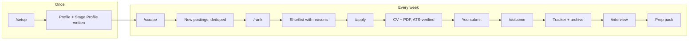
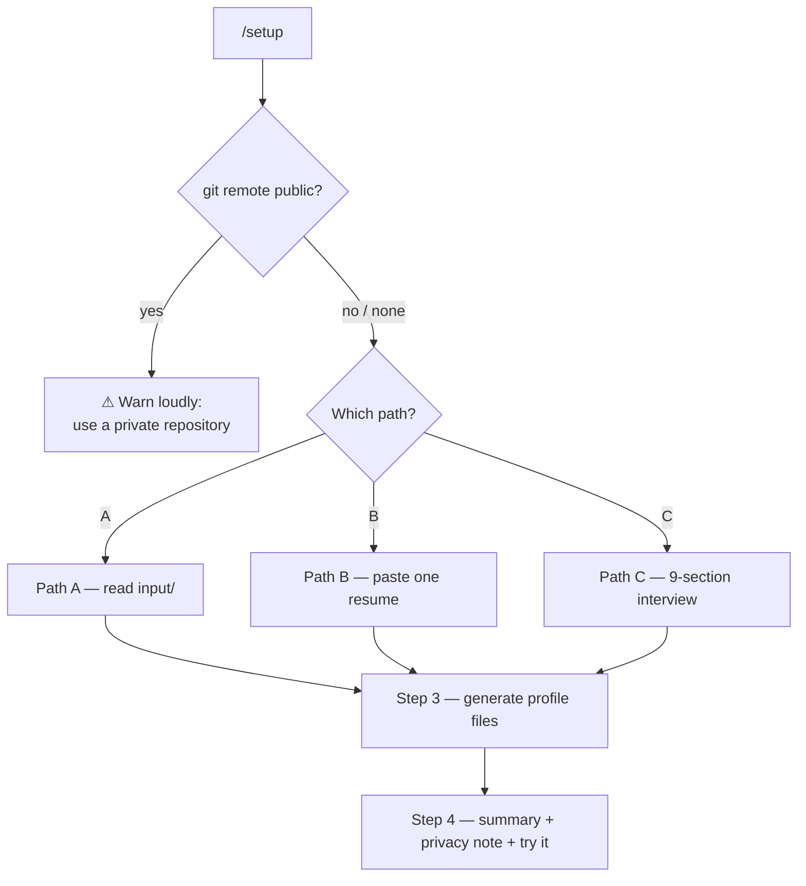
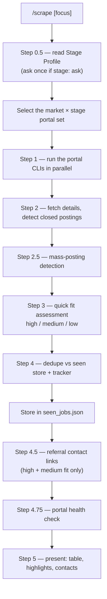
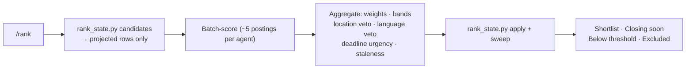
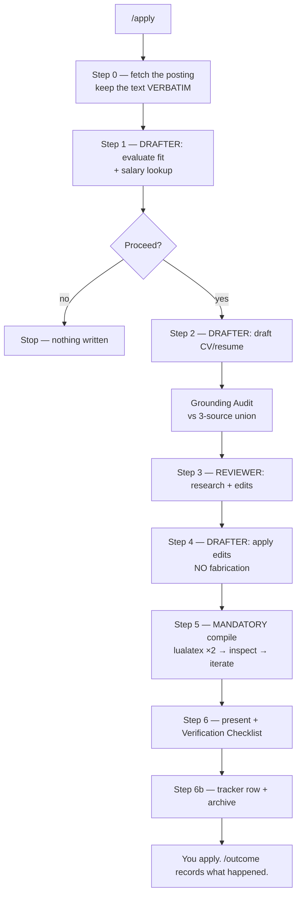
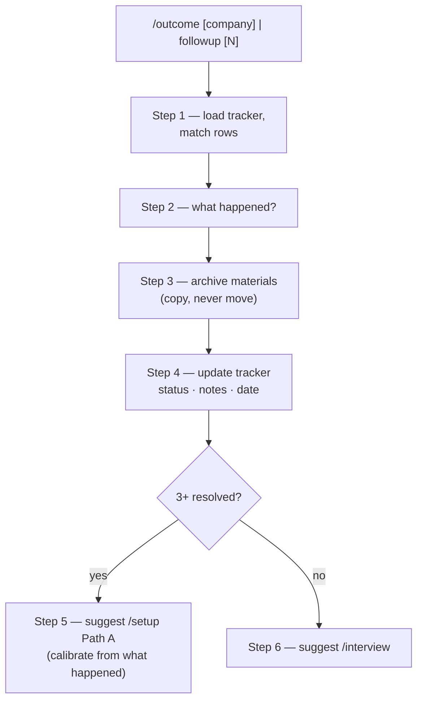
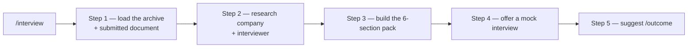

# UX Flows

> **Status:** `IMPLEMENTED` for the flows that exist; `PROPOSED` for the ones marked.
> This document describes the candidate's experience, not the agent's internal steps.

---

## 1. The candidate's mental model

ApplyOS is a **pipeline the candidate can interrupt**. The mental model is:

> *Point it at the market. It finds work, tells you what fits, drafts the documents, and keeps
> track. You press Send.*

Three properties make this believable:

1. **The candidate always knows what ApplyOS knows.** The Stage Profile is a small readable file
   the candidate can edit. The tracker is a CSV they can open in any spreadsheet.
2. **ApplyOS never acts irreversibly.** It drafts, it proposes, it archives. It never submits, never
   sends, never applies.
3. **Nothing surprises the candidate.** A new provider is disabled until they enable it. A sync
   proposes before it writes. A reset asks them to type `RESET`.

---

## 2. The primary flow

**The loop closes on `/outcome`.** Without it, `/apply` is a one-way door and the candidate learns
nothing from their search. `/outcome` records what happened, and the tracker becomes the input to
`/html-report` and to the next `/setup` calibration.

---

## 3. Flow: onboarding (`/setup`)

### 3.1 Entry and the privacy check

The first thing `/setup` does is check the git remote's visibility **before writing anything**,
because the profile is written into **tracked** files. The spec's own rule: *"A GitHub fork of
the template is always public (forks of public repos cannot be made private), so do not push
these commits to a fork."*

A candidate who does not notice will publish their name, email, phone number, salary
expectations, and employment history. This is the single highest-consequence moment in the
product, and it is the reason ADR-0003 exists.

### 3.2 Three paths

| Path | Input | Effort | Idempotent? |
|---|---|---|---|
| **A** — documents | `input/cv/`, `input/linkedin/`, `input/diplomas/`, `input/references/`, `input/postings/`, `output/applications/*/` | Lowest | **Yes** — "read-before-write", safe to re-run as material arrives |
| **B** — paste | One resume pasted in chat | Low | No — overwrites |
| **C** — interview | 9 sections: Identity, Education, Experience, Technical Skills, Publications/Awards, Behavioral, Career Goals, References, Job Search Configuration | Highest | Yes — re-runnable per section (`--section <name>`) |

**Path A's cross-reference step (A4)** surfaces inconsistencies between the CV, the LinkedIn
export, and the diplomas, and asks the candidate to resolve each one. This is the feature that
stops the profile from containing a contradiction the agent will later copy into a CV.

**Path C's Section 9** writes the Stage Profile — `stage:`, `market:`, `graduation_year:`,
`preferred_cities:`, `remote_preference:`, `stipend_floor:`, `expected_ctc_floor:`,
`notice_period:`. This is what makes `/scrape` ask-once rather than asking every run.

### 3.3 What the candidate sees at the end

A summary of what was written, the privacy note, and a suggested first command (`/scrape`).

---

## 4. Flow: discovery (`/scrape`)

### 4.1 The present step

The candidate sees a table of **new** postings (never a re-surfacing of something already seen),
ordered by fit, with:

- the posting URL,
- a one-line fit reason,
- the referral contact link where available,
- and, for any posting whose date could not be determined, a `"date unknown"` flag rather than a
  guess.

### 4.2 What the candidate does not see

- Nothing about a posting that was already seen.
- Nothing about a posting that failed at the source, beyond the health-check summary.
- No fabricated fields. An absent location is absent.

### 4.3 The health check

`/scrape health` probes the portals without searching, deduplicating, or presenting anything. Its
only permitted write is a provider's `enabled:` flag, and only with confirmation.

The spec is explicit that *"a 429 or block page is never evidence of breakage"* — a rate-limited
board is working correctly.

---

## 5. Flow: prioritisation (`/rank`)

### 5.1 The shortlist shape

Four sections, each with a distinct meaning:

| Section | Meaning |
|---|---|
| **Shortlist** | Above the threshold. Worth the candidate's time. |
| **Closing soon** | Above the threshold *and* the deadline is near. |
| **Below threshold** | Scored, but not recommended. Shown so the candidate can override. |
| **Excluded** | Gated out. Each row states the reason, quoted from the posting. |

The reason text is quoted evidence, not a category label: `"stale: posted 91d ago (> 30d window)"`,
not `"stale"`.

### 5.2 Overriding the ranking

The candidate can override. `/apply` re-runs the full evaluation, so a manual override is not a
special case — the candidate simply applies to a posting the ranker did not recommend, and the
evaluation is redone properly.

---

## 6. Flow: application (`/apply`)

This is the highest-stakes flow and it has the most structure.

### 6.1 The Grounding Audit

Before a draft is reviewed, every claim in it is checked against the union of three sources:

1. `01-candidate-profile.md`
2. the master CV
3. `CLAUDE.md` (the Candidate Profile block)

A claim present in none of them **is removed**. This is the mechanism behind the project's
core promise, and it is why the review step is a separate agent rather than the drafter checking
itself.

### 6.2 Step 5 is not optional

The spec: *"Step 5 (compile and inspect PDFs) is mandatory and non-skippable."* It is the moment
the candidate would otherwise discover a broken PDF. It compiles twice (for the cross-reference
pass), inspects the layout, iterates until clean, runs the ATS check, and cleans up the build
artifacts.

### 6.3 What the candidate receives

- The compiled `.pdf` and the `.tex` source.
- A **Verification Checklist** of four items.
- **Key Tailoring Decisions** — what was emphasised and what was dropped, and why.
- **Files Created** — the exact paths.

### 6.4 The document type rule

> *"Never produce both in one run unless the user explicitly asks."*

The candidate sends a CV **or** a resume, not a package. This keeps the workflow fast and the
output unambiguous. The type comes from the `Document type:` line in the profile, overridable with
`--cv` or `--resume`.

### 6.5 Page budgets

| Document | Budget | CI assertion |
|---|---|---|
| Resume | Exactly **1** page, at every stage | `--pages 1` |
| CV | Exactly **2** pages | `--pages 2` |
| CV, `student` / `fresher` stage | **1** page | Not pinned (the CV legitimately drops to 1) |

---

## 7. Flow: outcome and follow-up (`/outcome`)

### 7.1 The follow-up branch

| Rule | Value |
|---|---|
| Threshold | 7 days since the application |
| Draft length | 60–120 words |
| Channel | Shaped to the channel the application used |
| Maximum | Two follow-ups per application, then the thread closes |
| Sending | **Never.** Drafts only. *"It never emails, messages, or submits anything, and it must not be wired to tools that do."* |
| Claims | No new claims. A follow-up may reference only what was already true. |
| `drafted` rows | Listed, but never counted as "quiet" — they were never submitted |

### 7.2 The calibration loop

When three or more applications resolve, `/outcome` suggests re-running `/setup` Path A. This is
the mechanism that makes the framework improve with use: what the candidate actually sent
becomes the profile that the next draft is written from.

---

## 8. Flow: interview preparation (`/interview`)

**The six sections.** Likely questions · STAR answer mapping · Consistency brief · Tough
questions · Questions to ask · Logistics.

**The Consistency brief** is the section that makes this safe: it lists the facts from the
submitted document that the candidate must not contradict, and the gaps that must not be papered
over. The spec's rule: *"prep must never contradict it or coach claims beyond it."*

---

## 9. Flow: reporting (`/html-report`)

Read-only. Produces one self-contained file: inline CSS, inline JS, hand-written inline SVG
charts, no CDN and no external request of any kind. Opening it in a browser on a machine with no
network produces the same report.

**Data-only.** It never writes to the tracker or the archive.

**Idempotent.** Re-running overwrites the previous report at the same path.

**Drafted rows are excluded from every statistic** — they were never submitted, so counting them
as "applications" would be wrong.

---

## 10. Error and edge states

| Situation | What the candidate sees |
|---|---|
| `bun` not installed | `/scrape` fails loudly at the tool check (Step 1a) |
| `lualatex` not installed | `/setup` Step 3.10 fails loudly in the toolchain pre-flight |
| A portal is down | A note in the run summary; the run continues |
| A portal is rate-limited | Not treated as breakage; the health check leaves it alone |
| The posting is already seen | Nothing — it is not shown again |
| The posting is closed at the source | Skipped, not shown |
| The posting date is unknown | Shown with a `"date unknown"` flag |
| The profile has a contradiction | `/setup` Path A asks the candidate to resolve it |
| A claim cannot be grounded | The claim is **removed**, and the removal is visible in the review |
| The PDF will not compile | Step 5 iterates; if it cannot be made clean, no document is delivered |
| The text layer is not extractable | `verify_pdf.py` fails; no document is delivered |
| The tracker row is missing | `/outcome` creates the header and the row |
| Gmail MCP is absent | `/gmail-sync` stops at the prerequisite check with a clear message |
| Notion MCP is absent | `/notion-sync` exits gracefully at the preflight |
| The git remote is public | `/setup` warns **before** writing the profile |

---

## 11. Interaction principles

1. **Ask once, then remember.** The Stage Profile exists so `/scrape` asks for the stage exactly
   once.
2. **Never guess what you can ask.** Stage, market, document type, and status vocabularies are
   all settled by a question at the right moment.
3. **Show the reason.** Every gate failure, every exclusion, every warning states the evidence.
4. **Batch the approvals.** `/gmail-sync` proposes a batch of updates and waits once. Approving
   14 updates one at a time is worse than approving a list.
5. **Make the irreversible visible.** Deletions (`/reset`), submissions (the candidate does
   them), and sends (never automated) are all clearly marked.
6. **Keep the artifacts readable.** The tracker is a CSV. The profile is markdown. The Stage
   Profile is a small fenced block. The candidate can always open and edit them.
