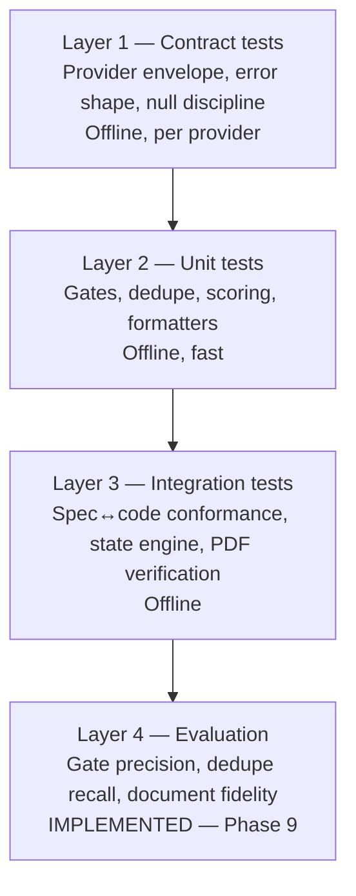

# Engineering

| Document | Contents |
|---|---|
| [standards.md](./standards.md) | Code, documentation, and contribution standards |
| [testing.md](./testing.md) | The test strategy across all four test layers |
| [evaluation.md](./evaluation.md) | Reproducible offline measurements — the missing piece today |
| [performance.md](./performance.md) | Budgets, measurement method, and known hot paths |

## The engineering baseline

As of commit `78813db`, verified locally on 2026-11-13:

| Gate | Command | Result |
|---|---|---|
| Python suite | `python -m unittest discover -s tests -t .` | 492 pass, 1 skipped |
| Engine tests | `cd applyos && bun run test` | 168 pass, 0 fail |
| Engine typecheck | `cd applyos && bun run --filter "*" typecheck` | 6/6 exit 0 |
| Provider CLIs | `bun run test` in each of 12 | 12/12 green |
| Skill lint | `python tools/lint_skills.py` | OK (34 skills, 12 commands) |
| Security guards | `python tools/security_guards.py` | OK |
| Framework version | `python tools/check_framework_version.py` | OK |

**CI runs all of these**, across three operating systems for the Python suite and the engine.

## The four test layers

Layers 1–3 exist and pass. **Layer 4 does not exist** — this is the single largest gap in the
project's quality infrastructure, and Phase 9 closes it.

## Three rules that override convenience

1. **Offline by default.** A test that touches the network must be gated behind
   `APPLYOS_LIVE_TESTS` and must never run in CI. Seven suites violated this before `78813db`.
2. **Fixtures, not live data.** Real postings are recorded as fixtures. A test that depends on a
   board's current HTML shape will fail on a Tuesday and pass on a Friday.
3. **A test must be able to distinguish the fix from the bug.** If a test passes both before and
   after the change, it proves nothing. `CONTRIBUTING.md` states this as a review requirement.

## Standards at a glance

| Area | The rule |
|---|---|
| TypeScript | `strict`, no `any` in exported signatures, explicit `null` over `undefined` for absent data |
| Python | Stdlib only for `tools/`; `unittest` for `tests/`; type hints on public functions |
| Errors | Typed codes; messages may change, codes may not |
| Comments | Explain *why*, not *what* — the codebase already does this well |
| Docs | Relative links; Mermaid for diagrams; status markers on every capability claim |
| Git | Conventional commits; one concern per PR |
| Secrets | Never in the repo; `<SERVICE>_API_TOKEN` environment variables only |
