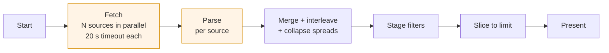

# Performance

> **Status:** `IMPLEMENTED` for the four offline commands in §6, whose budgets come from measured
> medians with a deliberate margin. Other numbers are either hard-coded constants in the source
> (cited) or explicitly left unproposed — no invented latency claims.
> **Related:** [OPEN_QUESTIONS.md Q8](../OPEN_QUESTIONS.md#q8--is-there-a-performance-budget-and-where-is-it-enforced--non-blocking).

---

## 1. The honest starting point

ApplyOS records `elapsedMs` on every search (`types.ts:33`, printed by `cli.ts:48`). The code
comment says it *"Feeds the speed SLO"* — **but no SLO is defined anywhere in the repository,
and no test asserts a latency ceiling.**

This document therefore separates three things that are often conflated:

| Category | Examples | Status |
|---|---|---|
| **Constants** | 20 s timeout, 1 retry, 300 ms pacing, 3-page default cap | `IMPLEMENTED` — they are in the source |
| **Measurements** | "a 12-portal scrape takes 4.2 s" | **Do not exist.** `UNKNOWN` |
| **Budgets** | "a scrape must complete in 10 s" | `PROPOSED` — a product decision, not a fact |

**No measurement is fabricated here.** Phase 9 produces the first measurements.

---

## 2. Known constants

| Constant | Value | Location |
|---|---|---|
| Default request timeout | 20 000 ms | `packages/core/src/fetch.ts:2` |
| Retries | exactly 1 | `packages/core/src/fetch.ts:16` |
| Inter-host pacing | 300 ms | `packages/core/src/fetch.ts:3` |
| User-Agent | `applyos/0.1 (personal use)` | `packages/core/src/fetch.ts:6` |
| Default page cap | 3 | `apps/cli/src/cli.ts:39` (`cliNumArg("--max-pages", undefined, 3, 20)`) |
| Maximum page cap | 20 | `apps/cli/src/cli.ts:39` |
| Default result limit | 20 | `apps/cli/src/cli.ts:38` |
| Maximum result limit | 1000 | `apps/cli/src/cli.ts:38` |
| Engine default staleness window | 90 days | `apps/cli/src/apply.ts:242` |
| `rank --limit` default | 10 | `/rank` Step 0 |
| `rank --top` default | 5 | `/rank` Step 0 |

---

## 3. Where the time actually goes



**Network dominates.** Parsing, merging, and filtering are pure in-memory operations over
hundreds of rows — they are not the bottleneck and should not be optimised prematurely.

### 3.1 The two serialisation points

Two places in the engine are deliberately sequential, and both are politeness decisions, not
performance oversights:

| Location | Decision | Reason |
|---|---|---|
| `apps/cli/src/apply.ts:75` | Batch packs build **sequentially in file order** | *"board-URL entries fetch live ATS pages, and fan-out against employer boards would break the politeness budget"* |
| `packages/company-scraper/src/search.ts` | Company boards fan out **sequentially** | One fetch pass per company per run — the politeness rule |

**Both should stay sequential.** A parallel batch would multiply simultaneous requests to
employer ATS servers, which is exactly what the politeness policy forbids. If a candidate needs
throughput, the answer is more time, not more concurrency.

### 3.2 The parallel point

`apps/cli/src/scrape.ts:97-115` runs the seven source pools concurrently — but each pool hits a
*distinct host*, so this is concurrency across different servers, not against one.

---

## 4. Known performance risks

| Risk | Evidence | Impact | Mitigation |
|---|---|---|---|
| **A cache-miss detail fans out to ~10 RSS feeds with no overall timeout** | Audit finding P-M12: `weworkremotely/commands/detail.ts:31-42` — *"cache-miss detail fans out ~10 RSS feeds → 15s→5 retries, no overall timeout → multi-minute `/scrape` hang"* | A single detail fetch can hang a `/scrape` run | **Not yet fixed.** Phase 11 |
| **A slow body read is not bounded by the signal alone** | `fetch.ts:38-49` — the body read races the remaining budget explicitly, because *"some runtimes do not abort an in-flight body read"* | Mitigated in the engine; not necessarily in all 12 provider CLIs, which have their own fetch code | Phase 4 unifies the fetch path |
| **The seen store grows without bound** | `tools/rank_state.py` — *"it grows for the life of the workspace"* | Reading it wholesale would cost tokens that scale with history | `candidates` projects; `sweep` retires. But the file itself is never compacted — see [OPEN_QUESTIONS Q9](../OPEN_QUESTIONS.md#q9--should-the-seen_jobsjson-store-grow-without-bound--non-blocking) |
| **A malformed posting makes the drafter loop long** | `/apply` Step 5 iterates the compile until clean | A template that cannot converge costs a full compile cycle per attempt | `/add-template` requires a successful test compile before activation |
| **Twelve `bun install` invocations** | The README's install loop | Slow first setup, and easy to forget one | Phase 1's bootstrap script |

---

## 5. The install-time cost

The current setup experience is:

```
for d in .agents/skills/*-search/cli; do (cd "$d" && bun install); done
```

**Twelve separate installs**, plus a **thirteenth** for the engine (`applyos/`) that the README
does not mention. Each provider CLI has zero runtime dependencies, so `bun install` fetches only
TypeScript types — but it is still twelve package resolutions.

**Phase 1** replaces this with one bootstrap script that installs everything and verifies the
toolchain. That is both a correctness fix (the engine is currently missed) and a
performance improvement.

---

## 6. Measured budgets (Phase 10)

Phase 9 produced the offline evaluation harness; Phase 10 measured the local commands with five
runs each on the reference machine (Windows, Bun 1.4.2, 2026-11-26) and set budgets with a
deliberate margin. The *median* and worst of five runs are the evidence; a budget is not a target,
it is a ceiling that catches a regression.

| Operation | Median / worst of 5 | Budget | Enforcement |
|---|---|---|---|
| `applyos eval --format json` | 55 ms / 57 ms | **500 ms** | The eval CI job runs the command; a breach exits 1 |
| `applyos contract --format json` | 50 ms / 51 ms | **500 ms** | CLI self-check under `--format json` |
| `applyos snapshot --format json` | 46 ms / 53 ms | **500 ms** | CLI self-check under `--format json` |
| `applyos doctor --format json` | 1032 ms / 1153 ms | **3000 ms** | Diagnostic ceiling; doctor checks its own elapsed time |
| `applyos rank` (100 postings, pure computation) | not measured through the CLI | **no budget** | The CLI fans out live providers; there is no offline flag to isolate scoring |
| `applyos apply` (single posting, pure computation) | not measured through the CLI | **no budget** | Same reason — the detail fetch is part of the command |
| A 7-portal scrape | — | **no budget proposed** | Dominated by network and third-party availability. A budget here would push toward behaviour that hurts boards. |

**Honesty note.** Only the four fully offline commands have measured budgets. The pure-computation
budgets proposed in earlier drafts (`rank` < 3 s, `apply` < 5 s) were **not** measurable through the
public CLI without a new offline flag, so they remain unproposed rather than being asserted as facts.
The ranking *stability* measurement from Phase 9 (ρ 1, σ 0) is the quality-side number the TUI
communicates; it is not a latency budget.

**The deliberate omission.** There is no proposed budget for a scrape. A scrape's duration is
bounded by the boards, not by ApplyOS. Budgeting it would create pressure to fetch less
politely — the exact wrong incentive. The budget that *should* exist is on the **failure**
path: a single source must never be able to hang the run (see §4, the `weworkremotely` risk).

---

## 7. Measurement method — `PROPOSED`

### 7.1 What to measure

| Metric | How | Where |
|---|---|---|
| Per-source fetch duration | `elapsedMs` per source, recorded in `SearchMeta.notes` | Engine |
| Total scrape duration | `SearchMeta.elapsedMs` | Already recorded |
| Detail fetch duration | Per-connector timer | New |
| Core compute time | `scrape` minus the sum of source times | New |
| `doctor` duration | Wall clock | New |
| Evaluation duration | Wall clock | New |

### 7.2 Where the measurement happens

**In the evaluation harness, not in production runs.** A production run should not write a
timing file; the candidate does not need it and it becomes personal data.

### 7.3 Baseline

`applyos/evals/baselines/performance.json`, in the same format as the other baselines. A
regression beyond the tolerance fails CI.

### 7.4 What is **not** measured

| Not measured | Why |
|---|---|
| Time to a job offer | Not a property of the software |
| Pages scraped per minute as a target | A throughput target invites the wrong behaviour against boards |
| Model latency in `/rank` | Depends on the provider and the account, not on ApplyOS |
| Memory usage | Not currently a constraint; the working set is hundreds of rows |

---

## 8. Optimisation guidance for contributors

**Do not optimise before measuring.** The engine's compute is not the bottleneck. If a change
makes the code faster but less readable, and no measurement justifies it, the change is a
regression in a codebase whose value is its legibility.

**When you do optimise:**

1. **Preserve the politeness contract.** No change may increase concurrency against a single
   host, reduce the pacing interval, or raise the retry count.
2. **Preserve the isolation contract.** One dead source must still never abort a run.
3. **Preserve the null discipline.** A faster path that skips a field is a correctness bug.
4. **Add a measurement to the evaluation harness** alongside the optimisation, so the next
   contributor can see the effect.

**Prefer structural simplifications over micro-optimisation.** In this codebase the wins have
been structural: `rank_state.py` removed the seen store from the model's context entirely, and
`interleave` (`dedupe.ts:47-62`) prevented one pool from starving the others. Both are larger
wins than any micro-optimisation, and both are readable.
