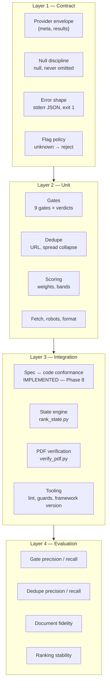

# Testing Strategy

> **Status:** All four layers are `IMPLEMENTED` and passing. Layer 4 (evaluation) was delivered in
> Phase 9 with a committed corpus, four offline runners and a CI tolerance gate.

---

## 1. The current test estate

| Suite | Count | Location | Network |
|---|---|---|---|
| Python tools | **492 pass, 1 skipped** | `tests/` | No |
| Engine (Bun) | **168 pass, 0 fail**, 22 files | `applyos/**/tests/` | No |
| Provider CLIs | **~495 across 12 suites** | `.agents/skills/*/cli/tests/` | No |
| **Total** | **~1,155 assertions-suites** | | |

Verification command from the repo root:

```
python -m unittest discover -s tests -t .
cd applyos && bun run test
cd applyos && bun run --filter "*" typecheck
for d in .agents/skills/*/cli; do (cd "$d" && bun run test); done
```

---

## 2. The four layers



---

## 3. Layer 1 — Contract tests

Every provider CLI's suite asserts the same five things. This is what makes twelve independent
implementations behave like one.

| # | Assertion | Bug it prevents |
|---|---|---|
| 1 | `search` returns exactly `{meta:{count,page}, results:[…]}` and `meta.count === results.length` | `weworkremotely` reported `meta.count ≠ results.length` |
| 2 | A source that omits a field yields `null` — not omitted, not `""`, not a placeholder | The `careers-search` em-dash bug across 8 connectors |
| 3 | A malformed response throws with a typed code; it does **not** return an empty page | `remoteok`'s HTML fallback fabricating a row; `wayup`'s `og:title` fallback |
| 4 | Errors go to stderr as `{"error","code"}` with exit 1; stdout stays clean | Silent partial failures |
| 5 | An unknown or valueless flag is rejected loudly | The bare `--query` → `"true"` class, present in **all** CLIs at the time of the audit |

**Fixture discipline.** Every provider test uses recorded fixtures, never live responses. A test
that depends on a board's current HTML will fail on a Tuesday and pass on a Friday.

---

## 4. Layer 2 — Unit tests

### 4.1 Gates — `applyos/packages/matching/tests/matching.test.ts`

The gate suite is the most valuable unit test in the repository, because each gate encodes a
decision that would otherwise be silently wrong. The cases that matter most are the **negative**
ones:

| Case | Assertion | Bug it prevents |
|---|---|---|
| Description absent | `PASS` with a `"not evaluated"` note | Fabricating "no stipend stated" on every posting |
| Description absent, batch gate | `PASS`, not `FLAG` | The same, for the batch gate |
| `"interviews at 3 p.m."` | Stipend gate does **not** read 3 | "3 p.m." parsed as a stipend of 3 |
| `"3 p.a."` | CTC gate does not fabricate "0.0 LPA" | Fabricating a CTC figure |
| `"a monthly stipend of INR 20000"` | Stipend gate reads 20000 | The unit-before-amount phrasing |
| `"a team of only 30 engineers"` | Batch gate does **not** read an exclusive restriction | The word "only" read from an unrelated clause |
| `"founded in 2019"` | No batch year is inferred | An incidental year read as a batch restriction |
| `"2026 batch only"` | Batch gate FAILs for a 2024 graduate | The gate that could never fire |
| Posting with no location | Location gate FAILs with "location unstated" | Passing a fabricated location |
| `"Bangalore"` | Matches a `Bengaluru` candidate | The alias map |
| Bond terms present | FLAG with the quoted terms, never FAIL | Auto-rejecting on a bond |
| CTC below floor | FLAG, never FAIL | Auto-rejecting on a mixed-comp posting |

### 4.2 Dedupe — `applyos/packages/core/tests/dedupe.test.ts`

| Case | Assertion |
|---|---|
| Tracking parameters | `?utm_source=…` does not create a second row |
| Trailing slash | `/job/1` and `/job/1/` are the same row |
| Hash fragment | `#apply` does not create a second row |
| Requisition spread | One posting across 5 cities collapses to one row with a spread note |
| Same-city duplicates | Collapse with **no** `"+0 cities"` junk note |
| Company in the key | Two boards' numeric ID `12345` do not collapse together |
| Calendar dates in a path | `2026-10-13` is not read as a requisition ID |

### 4.3 Scoring — `packages/matching/tests/matching.test.ts`

Stage weights, band boundaries, and the `notEvaluated` note for a missing description.

### 4.4 Fetch and robots

- Timeout is enforced; the body read races the remaining budget explicitly.
- Exactly one retry.
- The robots gate denies a disallowed path.
- **A headerless `robots.txt` is evaluated, not discarded** — the audit found this failing open,
  which turned `Disallow: /` into "allow everything".

---

## 5. Layer 3 — Integration tests

### 5.1 Tooling

| Tool | Test file | Covers |
|---|---|---|
| `tools/rank_state.py` | `tests/test_rank_state.py` | Selection, projection, write-back, sweep, the legacy migration, the null-is-not-a-correction rule, and the `AttributeError` fix for a non-object entry |
| `tools/verify_pdf.py` | `tests/test_verify_pdf.py` | Page count, text extraction, `--contains`, `--check-ats` |
| `tools/lint_skills.py` | `tests/test_lint_skills.py` | The linter itself, plus a negative case |
| `tools/security_guards.py` | `tests/test_security_guards.py` | Each guard fires on a violation |
| `tools/check_framework_version.py` | `tests/test_check_framework_version.py` | Version mismatch detection |
| `tools/robots_check.py` | `tests/test_robots_check.py` | Directive parsing, orphan blocks |
| `salary_lookup.py` | `tests/test_salary_lookup.py`, `test_salary_match.py` | Lookup and matching |

### 5.2 Spec conformance — `IMPLEMENTED`, Phase 8

Today, a spec's correctness is checked only structurally (`lint_skills.py`) and by the tests
attached to the tools it calls. A spec could say "read `output/cv/main_*`" when the file is
`resume_*` and nothing would catch it.

**Proposed conformance checks** (all offline, all cheap):

| Check | Method |
|---|---|
| Every path a spec mentions exists | Extract paths from the spec text; assert each exists |
| Every command a spec invokes is allowlisted | Extract `bun run …` / `python …`; assert each matches an allowlist entry |
| Every command a spec names exists | Assert the referenced command is in the repo |
| Every file a spec writes is under an allowed root | `input/`, `output/`, `workspace/`, or an explicitly-tracked profile file |
| Every status literal a spec uses is in the vocabulary | Cross-check against the tracker vocabulary |
| Every step is ordered and reachable | Numbered steps, no gaps, no forward references |

These turn a spec from prose into a **checkable artefact**, which is the missing half of
ADR-0001.

### 5.3 Contract tests across the layer boundary

`tests/test_scrape_contract.py` and `tests/test_allowlist_pairing.py` already check the seams
between the spec layer, the provider CLIs, and the permission allowlists. Phase 4 extends this
with the provider SDK, so the SDK, the CLI surface, and the engine all assert against one
contract.

---

## 6. Layer 4 — Evaluation — `IMPLEMENTED`, Phase 9

**This layer does not exist.** It is the largest quality gap in the project.

### 6.1 What an evaluation is

Not a unit test. A **measurement on a labelled corpus**, reproducible offline, with a committed
baseline. A unit test says "the gate returns FAIL for this input". An evaluation says "of the
postings a candidate would care about, the gates reject 0 of the good ones and reject 3 of the
40 irrelevant ones."

### 6.2 The four evaluations

| Evaluation | Question | Metric |
|---|---|---|
| **Gate precision** | Do the gates reject postings they should keep? | False-reject rate on a corpus of relevant postings |
| **Gate recall** | Do the gates catch postings they should reject? | False-accept rate on a corpus of irrelevant postings |
| **Dedupe precision** | Do two postings that a human would call the same collapse? | Pairwise precision/recall on labelled pairs |
| **Document fidelity** | Does every claim in a generated document trace to the profile? | Ungrounded-claim rate, via the Document Manifest |

Plus **ranking stability**: run the ranker twice over the same corpus and measure how much the
ordering moves. High movement means the score is noise.

### 6.3 Design constraints

1. **Offline.** No network, no model calls. Results must be identical on every machine.
2. **Committed corpus.** A directory of labelled fixtures with a schema and a licence statement.
3. **Committed baseline.** A JSON file of the last accepted results. A PR that moves a metric
   beyond its declared tolerance fails CI and asks for a justification.
4. **No invented numbers.** Until the corpus exists, every metric in this document is `UNKNOWN`,
   and this document says so.

### 6.4 Where the corpus comes from

Not from scraping live boards at evaluation time. The corpus is built **once**, from
already-collected fixtures, and committed. The build process is itself a one-time task in
Phase 9, documented, and reproducible — but the *evaluations* never hit the network.

---

## 7. Live testing

**CI makes no live portal requests.** This is a deliberate policy, and it was violated once:

> Seven portal suites were spawning the real CLI through `Bun.spawn`, so CI made live portal
> requests despite the workflow header and `CONTRIBUTING.md` both promising it does not.
> — `CHANGELOG.md`, `78813db`

Those blocks now skip unless `APPLYOS_LIVE_TESTS` is set.

**Local live testing** is a separate, on-demand step:

```
APPLYOS_LIVE_TESTS=1 bun run test        # in a provider CLI directory
```

**Why CI must not.** Naukri is bot-gated; `linkedin-search` is personal-use-only under its own
ToS; board availability varies by geography and hour. A CI run that hits real boards would be
flaky, slow, and in one case a ToS violation.

---

## 8. Test coverage, honestly

No coverage percentage is stated, and none should be, until it is measured.

**What is known.** The engine has 168 tests over 22 files covering all five packages. The gate
suite has explicit negative cases for every bug class the audit found. The Python suite is
stdlib-only and covers every tool including negative cases for the security guards.

**What is not known.** Line or branch coverage for any package. The engine's `tsc --noEmit`
passes, which is a type guarantee, not a behavioural one.

**Phase 9** produces the first measured numbers, and adds coverage reporting to the engine CI
job.

---

## 9. What a new test must satisfy

1. **It must fail before the fix and pass after.** A test that passes both ways proves nothing.
   `CONTRIBUTING.md`: *"all tests green" is checked against whether the tests can distinguish the
   old behavior from the fix.*
2. **It must run on the real path.** The failing input has to be one the workflow actually
   produces — the documented CLI invocation, real portal output, an actual data file — not a
   synthetic value fed straight into a function.
3. **It must be offline** unless explicitly gated.
4. **It must live in the right layer.** A provider contract belongs in that provider's suite; a
   gate belongs in `packages/matching`; a spec's structure belongs in `tests/`.
5. **It must be reproducible on three operating systems.** The CI matrix is not optional.
