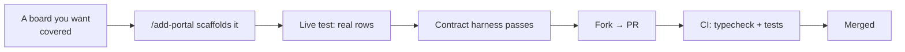

# Phase 12 — Packaging, distribution and ecosystem

> **Status:** `PROPOSED` · **Depends on:** Phases 4, 9, 11 ·
> **Risks:** [R-13, R-14, R-22, R-24](../roadmap/risks.md) ·
> **Resolves:** [Q6](../OPEN_QUESTIONS.md#q6--should-applyos-be-published-to-npm--non-blocking-for-phases-19-relevant-to-phase-12)

---

## Outcome

The provider SDK is installable by an external contributor, and the path from "I want to add a
job board" to "my board is in someone's search" is documented and short.

---

## Why now

Distribution should follow the substance, not precede it. A published package is a versioning
obligation and a support surface; it should follow a stable SDK (Phase 4), a measured quality
baseline (Phase 9), and a hardened posture (Phase 11).

The comparison project shows the shape of the opportunity: `npx @santifer/career-ops init` is its
primary distribution, and it has 82.3k stars. That is reach, not a requirement — ApplyOS's
identity is a private, India-focused, LaTeX-based workflow, and it should not become a generic
marketplace.

---

## Dependencies

| Dependency | Type | Status |
|---|---|---|
| Phase 4 (a stable provider SDK) | hard | Complete |
| Phase 9 (measured baselines) | hard | Complete |
| Phase 11 (hardened posture) | hard | Complete |
| **Q6** — publish to npm, or not | **decision gate** | **Open** |

---

## Affected modules

| Path | Change |
|---|---|
| `applyos/packages/provider/package.json` | The publishable SDK manifest, if publishing |
| `applyos/package.json` | The workspace's publication scope |
| `README.md` | The install section |
| `CONTRIBUTING.md` | The contribution funnel |
| `docs/developer/adding-a-portal.md` | The end-to-end worked example |
| `examples/` | A reference provider |
| `docs/research/` | The ecosystem analysis that informed the decision |

---

## Tasks

### 12.1 — Answer Q6

**Deliverable.** A decision, recorded with its reasoning.

**The options.**

| Option | Upside | Downside |
|---|---|---|
| **A. Publish the SDK to npm** | A contributor can `npm i @applyos/provider` and write a board without cloning the repo | A versioning obligation, a maintainer identity, a support surface, and a supply-chain consideration |
| **B. Publish nothing; distribution stays "clone the repo"** | No obligation, no surface | External contributors must clone to contribute — which the `/add-portal` flow already assumes |
| **C. Publish the SDK only** (not the CLI) | A small, focused package with a narrow surface | Still a versioning obligation, but a much smaller one |

**Recommendation.** **B for now, with C as the first step if Q6 turns positive.** The evidence
for demand is absent — no metric in this repository measures it. Phase 12's first task should be
to *create* that evidence rather than to act on it: publish nothing, add a clear "how to
contribute a provider" path, and revisit Q6 once there is evidence of external contributors.

**The constraint that survives any answer.** Whatever is published must preserve:
- zero runtime dependencies in a provider,
- the local-first property — a published package must not phone home,
- the portal-skill contract.

### 12.2 — Write the end-to-end worked example

**Deliverable.** `examples/` gains a complete, minimal provider that a contributor can copy.

**Requirements.**
- **It must actually work.** It must pass the contract harness and be registered in the
  `examples/` section of `search-queries.md`.
- **It must be small.** The point is that a board is ~300 lines.
- **It must be commented** at the level a first-time contributor needs.

### 12.3 — Document the contribution funnel

**Deliverable.** A section in `CONTRIBUTING.md` and `docs/developer/adding-a-portal.md`.

**The funnel.**

**Requirement.** Each step says exactly what to run and what "done" looks like. A contributor
should never have to read the engine's source to add a board.

### 12.4 — Make the contribution checklist machine-checkable

**Deliverable.** A `scripts/check-contribution.sh` (or a `make check`) that runs everything CI
runs, locally, in one command.

**Requirement.** It must not require network access beyond `bun install`. It must print a clear
summary of what passed and what failed.

### 12.5 — Write the "why ApplyOS" positioning

**Deliverable.** A short section in `README.md` and `docs/research/competitive-analysis.md`.

**The honest differentiators, verified against the repository:**

| Differentiator | Evidence |
|---|---|
| **LaTeX/moderncv documents with a verified ATS text layer** | `templates/cv-stock/`, `tools/verify_pdf.py --check-ats`, dual TeX Live CI legs |
| **India-specific job intelligence** | `search-queries.md`'s market×stage matrix, the Stage Profile, `04-job-evaluation.md`'s batch/stipend/CTC/notice-period gates |
| **Local-first, enforced by CI** | `tools/security_guards.py`, 26 KB of policy enforcement |
| **A deterministic core with an explainable score** | `packages/matching`, the 7 gates, the `not evaluated` discipline |
| **Runtime-agnostic** | The thin-pointer design, ADR-0001 and ADR-0002 |
| **Zero-dependency providers** | All 12 provider CLIs |

**What ApplyOS does not do and does not intend to.** Hosted service, telemetry, multi-language
documents, a web UI, auto-submission, email sending.

### 12.6 — Establish the release process

**Deliverable.** A documented release procedure and the automation to run it.

**Current state.** `CHANGELOG.md` follows Keep a Changelog with an `[Unreleased]` section. There is
**no tag or release automation** in `.github/workflows/`.

**Requirements.**
- A release is a vetting checkpoint on `main` — the `framework_version` markers tell a candidate
  which of their customised files a release touched.
- Every release updates `CHANGELOG.md` and the `framework_version` markers.
- The `framework_version` check (`tools/check_framework_version.py`) runs before a release.

**Automation.** `release-please` or a manual script. **Recommendation:** manual at first — the
release is a maintainer judgement about what is ready, and automating the judgement is the wrong
trade until there are several releases' worth of history.

### 12.7 — Write the ecosystem note

**Deliverable.** `docs/research/ecosystem-map.md` — the technologies ApplyOS depends on, their
maintenance status, and what happens if one is abandoned.

| Dependency | Type | If abandoned |
|---|---|---|
| Bun | Runtime | The engine and the provider CLIs need a rewrite |
| `lualatex` + TeX Live | Document toolchain | The documents need a new pipeline (ADR-0005) |
| `moderncv` | LaTeX class | The templates need a new class |
| Poppler / `pypdf` | PDF text extraction | `verify_pdf.py` needs another extractor |
| Python | Runtime for `tools/` | The tooling needs a rewrite |

---

## Tests

| Suite | Change |
|---|---|
| `examples/<provider>/cli/tests/` | The example provider's contract harness |
| `tests/test_readme_assets.py` | Extended for the new install instructions |
| `.github/workflows/ci.yml` | The example provider is discovered by the existing matrix |

---

## Acceptance criteria

- [ ] Q6 is answered and recorded.
- [ ] A worked example provider exists, works, and passes the contract harness.
- [ ] The contribution funnel is documented end to end.
- [ ] One command runs everything CI runs.
- [ ] The positioning states the differentiators and the non-goals, with evidence.
- [ ] The release procedure is documented.
- [ ] The ecosystem note exists.
- [ ] The whole suite is green on three operating systems.

---

## Risks

| Risk | Likelihood | Impact | Mitigation |
|---|---|---|---|
| Publishing creates a support burden the project cannot carry | medium | high | The recommendation is **not** to publish until there is evidence of external demand. Q6 is a decision, not a default |
| A published package becomes a supply-chain vector | medium | critical | The published package must have zero runtime dependencies and must not phone home. Phase 11's threat model covers it |
| The contribution funnel stays undiscoverable | high | medium | The worked example, the one-command check, and a link from the README |
| Scope creep into a marketplace | medium | medium | The plugin architecture explicitly defers Layer 3 |
| A release process that is too manual | high | low | At one maintainer's scale, manual is correct. Automate when it is not |

---

## Rollback

| Change | Rollback |
|---|---|
| Publishing | Unpublish. The in-repo path never changes |
| The example provider | Delete it |
| The contribution funnel | Documentation only |
| The release automation | Remove the workflow |

---

## Definition of done

- [ ] All acceptance criteria pass in CI on three operating systems.
- [ ] Q6 is closed in `docs/OPEN_QUESTIONS.md`.
- [ ] `docs/IMPLEMENTATION_STATUS.md` reflects the distribution state.
- [ ] `docs/research/` gains the ecosystem note.
- [ ] `CONTRIBUTING.md` and `docs/developer/adding-a-portal.md` carry the funnel.
- [ ] `CHANGELOG.md` has an `[Unreleased]` entry.
