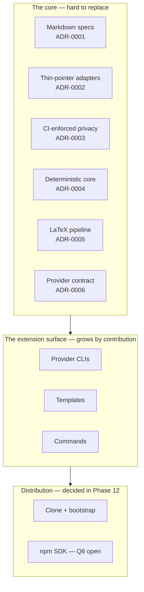

# Technology and Ecosystem

> **Checked:** 2026-11-13.
> **Purpose:** what ApplyOS depends on, what happens if each dependency is abandoned, and what the
> alternatives are.
> **Status:** `IMPLEMENTED` — Phase 12 reviewed it and published the dependency/fallback inventory
> in [ecosystem-map.md](./ecosystem-map.md).

---

## 1. Runtime and tooling dependencies

| Dependency | Version | Used by | Why it was chosen | If abandoned |
|---|---|---|---|---|
| **Bun** | 1.4.3 (`applyos/.bun-version`) | The engine; the 12 provider CLIs | Single-file execution (`bun run src/cli.ts`), a built-in test runner, built-in TypeScript, and a workspace linker. One tool covers all four needs | The provider CLIs need a different TS runner and the engine's workspace resolution breaks |
| **TypeScript** | 5.9.3 | Everywhere in TypeScript | Types are the provider contract; `tsc --noEmit` is a CI gate | JavaScript loses the contract check |
| **Python** | 3.10+ (3.12 in CI) | `tools/`, `tests/`, `salary_lookup.py` | Stdlib-only means no install step and no dependency risk for the tooling | The tooling needs a rewrite. It is small enough that this is survivable |
| **LaTeX** (`lualatex`) | TeX Live 2022+ and current | `/apply` Step 5 | Deterministic page counts; a machine-extractable text layer; a version-pinnable toolchain | The document pipeline needs replacing (ADR-0005). See §3 |
| **moderncv** | 2.3.1 and 2.5+ | Both stock templates | The CV and resume share a class and a design system | The templates need a new class. The CI matrix deliberately spans both versions for this reason |
| **Poppler** (`pdftotext`, `pdfinfo`) | any recent | `verify_pdf.py` — the fallback extractor | The reference text-layer extractor | `pypdf` is the primary path; Poppler is the fallback. Either alone suffices |
| **pypdf** | optional | `verify_pdf.py` — the primary extractor | Pure Python; no system install | Poppler covers it |
| **git** | any | Branching, the `/setup` privacy check | — | The privacy check is skipped |
| **GitHub CLI** (`gh`) | optional | `/setup`'s visibility check | Reads `visibility` and `isFork` without an API token | The check degrades to the remote URL |

---

## 2. External services (opt-in)

| Service | Used by | What crosses | Required? |
|---|---|---|---|
| **Gmail** (via MCP) | `/gmail-sync` | A search query and thread reads | **No.** The command stops at its prerequisite check |
| **Notion** (via MCP) | `/notion-sync` | Posting metadata and **filenames only** | **No.** The command exits gracefully at its preflight |
| **A model provider** | Every command | The agent's context | **Yes, in practice.** The candidate chooses it |
| **Job boards** | `/scrape`, `/apply` | Search queries and posting fetches | Yes, for the boards in use |

**The MCP bindings are Claude-specific** (`mcp__claude_ai_Gmail__*`, `mcp__notion__*`). Phase 8
resolves this into a capability-based binding — Q11.

---

## 3. The LaTeX dependency, in detail

The single heaviest external dependency, and the one most worth understanding.

### 3.1 Why LaTeX rather than HTML

See [ADR-0005](../architecture/adr/0005-latex-document-pipeline.md) for the full comparison. The
short version: LaTeX gives a deterministic page count and a reliable text layer, which are the
two properties an ATS depends on. HTML + Playwright gives a nicer authoring experience and a
heavier prerequisite.

### 3.2 The version matrix

CI compiles both stock templates on **two** TeX environments:

| Leg | Environment | moderncv | When |
|---|---|---|---|
| `latex-smoke` | `texlive/texlive:latest` | 2.5+ | Every push and PR |
| `latex-smoke-bookworm` | `debian:bookworm` (TeX Live 2022) | 2.3.1 | Weekly schedule and manual dispatch |

**Why two.** The TeX Live 2022 leg exists because that environment hit environment #242 — a
moderncv break that only appeared on the older distribution. The Debian leg was moved to a
weekly schedule because pulling `texlive:latest` plus the bookworm install dominates CI minutes.

The README's Linux setup path is `apt`, so **both ends of the moderncv range users actually have**
stay covered.

### 3.3 The minimal package set

```bash
apt install -y --no-install-recommends \
  texlive-luatex texlive-latex-extra \
  texlive-fonts-extra texlive-fonts-recommended \
  poppler-utils python3
```

`moderncv` loads **fontawesome5** (`texlive-fonts-extra`) and `hyperref` probes the **pzdr**
metrics (`texlive-fonts-recommended`). Missing either is a **fatal** error, not a warning.

### 3.4 The known sharp edges

| Edge | Why | Where it is handled |
|---|---|---|
| The phone placeholder | A bare `_` is a LaTeX subscript and aborts the compile. Use `+91 XXXXX XXXXX`, never `[YOUR_PHONE]` | `/setup` Step 3, `/reset` Step 3 |
| Two compile passes | The second pass resolves the cross-references | `/apply` Step 5a |
| Build artifacts | `.aux`, `.log`, `.out` pollute the output directory | `/apply` Step 5e cleans them |
| `\name{\[First\]}{\[Last\]}` | The placeholder tokens must survive in the tracked template | CI `placeholder-integrity` |

---

## 4. The zero-dependency property

**Every provider CLI and the engine declare `dependencies: {}`.**

This is not asceticism. It is the reason a board contribution is a folder that works anywhere
`bun` exists, with no install step, no lockfile resolution, and no supply-chain surface.

**The enforcement.** `tools/security_guards.py` scans every `package.json` under `.agents/**`
**and** `applyos/` for lifecycle scripts. Phase 4 adds a check that the SDK's `dependencies` is
also empty.

**The known gap.** The provider CLIs' `bun.lock` files are **gitignored** (audit finding T-m8:
*"portal `bun.lock`s ignored (unpinned installs)"*). The `devDependencies` are version-pinned,
but without a committed lockfile a transitive dev dependency could drift. The exposure is
limited — dev dependencies do not ship — but it is real and Phase 11 should address it.

---

## 5. The CI dependency set

| Action | Why | Pinned? |
|---|---|---|
| `actions/checkout` | Every job | ✅ SHA |
| `actions/setup-python` | The Python legs | ✅ SHA |
| `oven-sh/setup-bun` | The engine and CLI legs | ✅ SHA |
| `actions/cache` | The Bun cache | ✅ SHA |
| `actions/dependency-review-action` | PR dependency scanning | ✅ SHA |

**All actions are pinned to commit SHAs, not tags.** The token is read-only
(`permissions: contents: read`).

**The known limitation, stated in the workflow's own header:**

> a PR can edit this workflow itself, so these guards catch accidents and casual attempts, not a
> determined author — branch protection with required checks and human review of
> workflow/settings diffs remain the real backstop.

---

## 6. The tooling dependencies

| Tool | Stdlib only? | Role |
|---|---|---|
| `tools/rank_state.py` | Yes | The seen store: select, sweep, write-back |
| `tools/verify_pdf.py` | Yes (plus optional `pypdf`/Poppler) | Page count, text layer, ATS check |
| `tools/security_guards.py` | Yes | The repository's policy enforcement |
| `tools/lint_skills.py` | Yes | Spec structure |
| `tools/robots_check.py` | Yes | robots.txt evaluation |
| `tools/check_framework_version.py` | Yes | Version drift |
| `tools/convert_salary_excel.py` | Yes | Salary spreadsheet → JSON |
| `salary_lookup.py` | Yes | Salary lookup |

**The stdlib-only rule has a purpose.** CI runs `python -m unittest discover -s tests -t .` with
**no `pip install`**. A contributor on any machine with Python 3.10+ can run the full suite. The
one exception — `pypdf` — is optional and has a fallback.

---

## 7. Adjacent ecosystems

| Ecosystem | Relationship |
|---|---|
| **OpenCode** | The reference runtime. `opencode.json` holds the permission allowlist; `.opencode/command/` holds the adapters |
| **Claude Code** | A first-class runtime. `.claude/` loads natively; `.claude/settings.json` holds the allowlist |
| **Codex CLI, Antigravity, ZCode, FreeBuff** | Supported through the `AGENTS.md` routing table |
| **The OpenCode skills catalogue** | The broader extension ecosystem. Many overlapping job-search skills exist; ApplyOS's differentiator is the enforced contract, the India intelligence, and the CI-enforced privacy model |
| **The job-board ecosystem** | Naukri, Internshala, Unstop, Cutshort, Wellfound, LinkedIn, WayUp, RemoteOK, Remotive, We Work Remotely, FreeHire, and eight ATS families via `careers-search` |
| **The LaTeX ecosystem** | `moderncv`, `fontawesome5`, `hyperref`, and the TeX Live distributions |

---

## 8. Alternatives considered, per dependency

| Dependency | Alternative | Why not |
|---|---|---|
| **Bun** | Node.js | Node would need a separate TS runner, a separate test runner, and a separate workspace solution — three dependencies to replace one. Bun also runs a `.ts` file directly, which is what makes a provider CLI a single file |
| **Bun** | Deno | Comparable, but a smaller ecosystem for the CLI patterns used here, and no equivalent workspace-plus-bundled-test-runner combination |
| **TypeScript** | JavaScript with JSDoc | Loses the compile-time contract check that catches provider mismatches |
| **Python** | Node for the tooling | The tooling would join the engine's workspace and need a runtime dependency anyway; keeping the tooling stdlib-only keeps `python tools/*.py` usable from any runtime |
| **LaTeX** | HTML + Playwright | A browser prerequisite; less predictable ATS text extraction; no deterministic page budget |
| **LaTeX** | Typst | `moderncv` is LaTeX. `/add-template` already accepts a Typst compile command for custom templates |
| **Poppler** | pypdf only | Poppler is more universally available; pypdf needs a pip install. Supporting both is the most robust |
| **MCP** | Direct API clients | An API client needs a credential for every service the candidate might use. MCP is capability-based and the candidate configures what they have |
| **CI actions** | Self-hosted runners | A supply-chain surface that a small project should not take on |
| **A JSON schema tool** | Hand-written validators | A dependency, and the hand-written version gives better error messages — the engine's `apply.ts:141-151` validates element shapes and names the offending field |

---

## 9. Watch list

Things to watch for the ecosystem, and why.

| Watch | Why |
|---|---|
| **Bun's release cadence** | The project pins 1.4.3. A breaking change in the workspace linker or the test runner would be felt immediately |
| **moderncv** | Its 2.3→2.5 transition already broke one environment. The CI matrix spans both for that reason |
| **TeX Live distributions** | A distribution dropping a package `moderncv` needs is the most likely CI breakage |
| **The job boards** | Every provider is a parser against a site that can change without notice. The contract requires failing loudly on a shape change — a provider that silently returns fewer rows is the failure mode to watch |
| **The MCP specification** | The binding names are runtime-specific today. If the spec standardises capability discovery, Phase 8 gets simpler |
| **Naukri's bot-gate** | Already documented in `search-queries.md` as needing a WebSearch fallback. It will change; the fallback path needs to stay working |
| **The `bun.lock` gap** | Dev dependencies are unpinned in practice. Phase 11 should decide whether to commit the lockfiles |

---

## 10. The ecosystem note

**The shape of ApplyOS's ecosystem position.**



**The bet.** The core is small, stable, and CI-enforced. The extension surface grows by
contribution. Distribution is the last decision, made when there is evidence.

**The risk.** If the extension surface is not cheap enough for external contributors, the core's
strength does not compound. Phase 12's funnel is what makes it compound.
