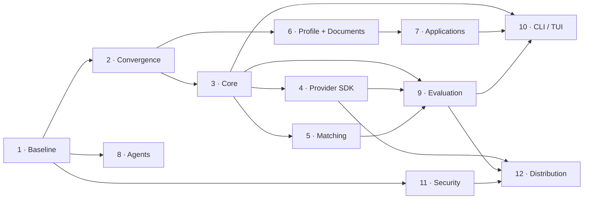

# Roadmap

| Document | Contents |
|---|---|
| [master-roadmap.md](./master-roadmap.md) | The twelve phases, their outcomes, and the sequencing rationale |
| [dependencies.md](./dependencies.md) | The dependency graph and the critical path |
| [risks.md](./risks.md) | The risk register with mitigations and owners |

## How to read the roadmap

The roadmap is **not** a wishlist. Every phase:

- has a **concrete outcome** that can be verified,
- names the **modules it touches**,
- lists its **dependencies**,
- has **acceptance criteria** that are checkable,
- has a **rollback** that leaves the repository working,
- and states its **risks** up front.

A phase is done when its acceptance criteria pass in CI — not when its code is written.

## The shape of the plan

**Phase 2 is the hinge.** Everything downstream — the provider SDK, the unified scoring model,
the evaluations, the TUI — depends on the engine and the spec layer having been reconciled. If
ADR-0007 is rejected, phases 3–5 change shape substantially and phases 9–10 lose their
foundation.

## What this roadmap deliberately does not do

| Not planned | Why |
|---|---|
| A hosted service | Breaks ADR-0003 |
| Telemetry | Same |
| Multi-language documents | A deliberate v1 exclusion |
| A web UI | The candidate's machine is the trust boundary |
| A plugin marketplace | An undesigned trust model — see [../design/plugin-architecture.md](../design/plugin-architecture.md) |
| More than one core lifecycle command | `CONTRIBUTING.md` sets a high bar; the lifecycle is feature-complete |
| Publishing to npm before Phase 12 | [Q6](../OPEN_QUESTIONS.md#q6--should-applyos-be-published-to-npm--non-blocking-for-phases-19-relevant-to-phase-12) is unresolved |

## Effort

**Not estimated here.** The repository contains no historical velocity data, and a schedule
estimate built from nothing would be fabricated. Each phase instead states its **scope** in
terms of files, modules, and acceptance criteria, so a maintainer can size it against their own
capacity.

What *is* stated is the **ordering constraint** — which phase cannot start until another
finishes, and why. That is the part that is knowable from the code.
