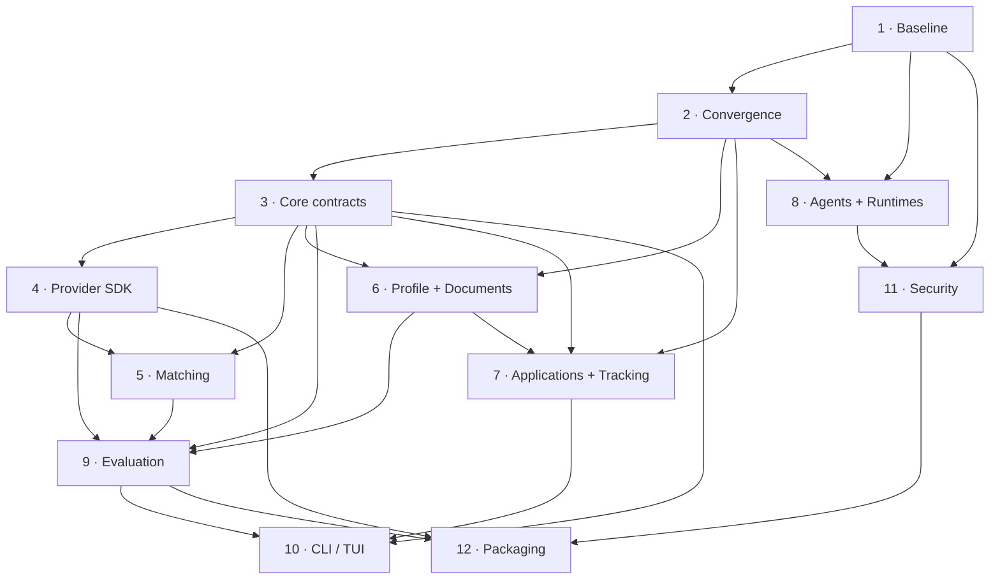

# Dependencies

> The ordering constraints between phases, and the ones between modules inside a phase.

---

## 1. Phase dependency graph



| Phase | Hard dependencies | Soft dependencies | Can start without? |
|---|---|---|---|
| 1 | — | — | ✅ Yes |
| 2 | 1, ADR-0007 | — | ❌ |
| 3 | 2 | — | ❌ |
| 4 | 3, ADR-0008 | 2 | ❌ |
| 5 | 3, 4, Q2 | — | ❌ |
| 6 | 2, 3 | — | ❌ |
| 7 | 2, 3, 6 | — | ❌ |
| 8 | 1, 2 | — | ❌ |
| 9 | 3, 4, 5, 6 | — | ❌ |
| 10 | 3, 7, 9, Q10 | — | ❌ |
| 11 | 1, 8 | Everything else informs it | ⚠️ Partially — the known gaps can be fixed early |
| 12 | 4, 9, 11, Q6 | — | ❌ |

---

## 2. The critical path

**1 → 2 → 3 → 4 → 9 → 10 → 12**

Each link is a genuine ordering constraint, not a preference:

| Link | Why the successor cannot start earlier |
|---|---|
| 1 → 2 | Phase 2 rewrites spec steps. Doing that without a green baseline means a broken repository with two simultaneous causes |
| 2 → 3 | The shared contract's home depends on whether the engine or the spec layer owns it |
| 3 → 4 | The SDK's types are the shared contract. Building an SDK over an unsettled contract guarantees rework |
| 4 → 9 | The corpus is built from provider output; the dedupe and gate evaluations need one canonical implementation |
| 9 → 10 | The TUI renders a shortlist. Its design depends on how stable that shortlist is |
| 9 → 12 | Publishing before the measurements exist means publishing an unmeasured quality claim |
| 11 → 12 | The threat model must describe the final architecture, not the pre-convergence one |

**Phases 5, 6, 7, 8 run in parallel with each other** once Phase 3 completes, subject to their
individual dependencies. 5 depends on 4; 6 depends on 3; 7 depends on 6; 8 depends on 2.

---

## 3. Decision dependencies

Some phases are blocked not by code but by a decision.

| Decision | Blocks | Where it is decided | Fallback if undecided |
|---|---|---|---|
| **ADR-0007** — engine as core, parallel, or retired | Phase 2, and everything after | [../architecture/adr/0007-converge-engine-and-workflows.md](../architecture/adr/0007-converge-engine-and-workflows.md) | Keep the engine experimental; phases 4, 5, 9, 10 change shape |
| **ADR-0008** — one implementation per board | Phase 4 | [../architecture/adr/0008-single-provider-implementation.md](../architecture/adr/0008-single-provider-implementation.md) | Accept the duplication; the SDK becomes an adapter layer, not a foundation |
| **Q2** — which scoring model is canonical | Phase 5 | Phase 5's design | Ship both, documented as two products — the worst option |
| **Q6** — publish to npm | Phase 12 | Phase 12's design | Distribution stays "clone the repo"; the contribution funnel is `/add-portal` in a fork |
| **Q10** — who consumes the CLI JSON | Phase 10 | Phase 10's design | The dashboard continues to read the CSV directly |
| **Q7** — the install experience | Phase 1 | Phase 1's bootstrap design | The status quo: two install loops and a confusing first run |

---

## 4. Module-level dependencies inside a phase

### Phase 3 — Core contracts

```
packages/core/src/types.ts        ← the home of JobPosting
        ▲          ▲         ▲
        │          │         │
   portals/    company-   matching/
                scraper/
        ▲
   apps/cli
```

**Ordering inside the phase.** Move the contract first; then update each consumer; then delete the
old location. Never update a consumer before the contract has a new home — that produces a window
where two definitions exist and one is wrong.

### Phase 4 — Provider SDK

```
sdk/provider.ts   ← the interface
      ▲
      │
cli/<board>/src/provider.ts   ← one implementation per board
      ▲
      │
cli/<board>/src/cli.ts        ← a thin surface over the implementation
```

**Ordering.** The SDK interface, then **one** board (remoteok — smallest), verified against the
existing implementation's output on identical queries, then the rest.

**Do not** migrate `careers-search` and `packages/company-scraper` in the same pass as the
aggregator boards. They are different lifecycles (detect → search → detail) and merging them
simultaneously with five other migrations makes the change unreviewable.

### Phase 5 — Matching

```
matching/src/weights.ts   ← the ONE weight table
        ▲
        ├── matching/src/score.ts
        ├── tools/rank_state.py   ← reads the same table
        └── 04-job-evaluation.md  ← documents the same table
```

**Ordering.** Establish the single source, then make the code read it, then make the docs
describe it, then delete the duplicates.

### Phase 6 — Profile + documents

```
profile schema (new)  ──▶  profile validator  ──▶  profile loader
                                                      │
docgen ──▶ Document Manifest ──▶ document-fidelity evaluation
```

**Ordering.** The manifest must exist before Phase 9's document evaluation. The manifest and
the profile schema are independent and can be built in parallel.

### Phase 9 — Evaluation

```
corpus (new)  ──▶  runners  ──▶  baselines  ──▶  CI gate
```

**Ordering.** The corpus must be committed before any runner produces a number, and the
baseline must exist before the CI gate can be meaningful. A runner with no corpus produces
nothing.

---

## 5. Cross-phase dependencies on open questions

| Question | Asked in | Answered by | If unanswered |
|---|---|---|---|
| Q1 engine role | Phase 0 | Phase 2 start | Phase 2 cannot start |
| Q2 scoring model | Phase 0 | Phase 5 | **Resolved** — one weights table, four dimensions, five bands (ADR-0009) |
| Q5 board duplication | Phase 0 | Phase 4 | **Resolved** — one SDK implementation per board, unified registry |
| Q6 npm | Phase 0 | Phase 12 | **Resolved** — publish nothing; SDK-only if external demand appears |
| Q7 install | Phase 0 | Phase 1 | **Resolved** — bootstrap scripts + `applyos doctor` |
| Q8 performance budget | Phase 0 | Phase 9/10 | **Resolved** — measured ceilings for four offline commands |
| Q9 seen-store compaction | Phase 0 | Phase 3 | **Resolved** — `compact` subcommand, dry-run by default |
| Q10 CLI consumer | Phase 0 | Phase 10 | **Resolved** — `applyos snapshot` is the stable data contract |
| Q11 MCP fallback | Phase 0 | Phase 8 | **Resolved** — capability bindings with a manual degraded mode |
| Q12 review policy | Phase 0 | Phase 11 | Open — operational, not a code blocker |

---

## 6. Dependencies that are **not** real

Recorded so a future contributor does not preserve a false constraint.

| Apparent dependency | Reality |
|---|---|
| The provider SDK needs a published npm package | No. `cli-shared` proves relative-path sharing works in-repo |
| The TUI needs the engine to be rewritten first | No. It needs the **contract** (Phase 3) and a stable tracker (Phase 7) |
| Evaluation needs a live board | No. The corpus is committed; evaluations are offline by design |
| The document manifest needs the LaTeX pipeline changed | No. The manifest is a sidecar; the pipeline is unchanged (ADR-0005) |
| The tracker schema needs the TUI | The reverse. The schema comes first |
| Publishing needs a launch announcement | Out of scope. The roadmap is about the repository |
