# Master Roadmap

> Twelve phases. Each is independently shippable and ends with a green-CI repository.
> The per-phase plans live in [../phases/](../phases/README.md).
> **Status:** `IMPLEMENTED` — all twelve phases are complete; the only outstanding evidence is the
> three-OS CI matrix. See [../IMPLEMENTATION_STATUS.md](../IMPLEMENTATION_STATUS.md) for current
> state and [../OPEN_QUESTIONS.md](../OPEN_QUESTIONS.md) for the decisions that were resolved.

---

## 1. The twelve phases at a glance

| # | Phase | Outcome | Key modules | Depends on |
|---|---|---|---|---|
| 1 | [Repository baseline](../phases/phase-01-repository-baseline.md) | A clone installs and verifies in one command; docs tell the truth | `README.md`, `SETUP.md`, `docs/`, CI | — |
| 2 | [Architecture convergence](../phases/phase-02-architecture-convergence.md) | One core, two consumers | `applyos/**`, `.claude/commands/*` | 1, **ADR-0007** |
| 3 | [Deterministic core](../phases/phase-03-deterministic-core.md) | One `JobPosting`, one provider contract, one state contract | `packages/core`, `tools/rank_state.py` | 2 |
| 4 | [Provider SDK](../phases/phase-04-provider-sdk.md) | One implementation per board | `.agents/skills/*/cli`, `packages/portals` | 3, **ADR-0008** |
| 5 | [Job intelligence](../phases/phase-05-job-intelligence.md) | One explainable scoring model | `packages/matching`, `04-job-evaluation.md` | 3, 4, **Q2** |
| 6 | [Profile + documents](../phases/phase-06-profiles-and-documents.md) | Machine-readable profile; machine-checkable claims | `01-candidate-profile.md`, `packages/docgen`, `05-cv-templates.md` | 2, 3 |
| 7 | [Applications + tracking](../phases/phase-07-application-workflows.md) | A versioned tracker contract | `tools/rank_state.py`, `/outcome`, `/apply` | 2, 6 |
| 8 | [Agents + runtimes](../phases/phase-08-ai-agents-and-runtimes.md) | One invocation shape for every runtime | `AGENTS.md`, `.opencode/`, `.claude/` | 1, 2 |
| 9 | [Evaluation](../phases/phase-09-evaluation.md) | Reproducible offline measurements | `applyos/evals/` (new), CI | 3, 4, 5, 6 |
| 10 | [CLI, TUI, dashboard](../phases/phase-10-cli-tui-dashboard.md) | An optional local UI over the same core | `applyos/apps/cli`, `output/reports/` | 3, 7, 9 |
| 11 | [Security hardening](../phases/phase-11-security-hardening.md) | A documented threat model; the known gaps closed | `tools/security_guards.py`, `SECURITY.md` | 1–10 |
| 12 | [Packaging + ecosystem](../phases/phase-12-packaging-distribution.md) | An installable provider SDK; a contribution funnel | `applyos/`, `CONTRIBUTING.md` | 4, 9, 11 |

---

## 2. Sequencing rationale

### 2.1 Why the baseline comes first

The repository currently fails its own "clone and verify" experience: the README's install loop
covers the twelve provider CLIs but **not** `applyos/`, so `bun test` in the engine fails with
`Cannot find module '@applyos/core'` on a fresh clone. The local toolchain is also missing
`lualatex` and Poppler.

Every later phase assumes a contributor can get to a green state. Phase 1 makes that true and
fixes the documentation drift that would mislead every subsequent contributor.

### 2.2 Why convergence precedes the SDK

The provider SDK (Phase 4) must be built **on top of** the shared `JobPosting` contract and the
core's fetch/robots/dedupe policy. If the SDK is built while the engine and the spec layer still
disagree about what a "posting" is, the SDK inherits the ambiguity and Phase 5 has to unpick it.

Phase 2 is therefore first, and it is deliberately the smallest useful slice: it does not
rewrite anything, it only establishes the shared contract and proves the two layers can talk.

### 2.3 Why matching comes before evaluation

An evaluation of a scoring model is only meaningful once there is one scoring model. Phase 5
picks the canonical model (Q2), makes it explainable, and exposes its weights and version. Phase 9
then measures it. Doing evaluation first would measure two models and produce two numbers that
cannot be compared.

### 2.4 Why documents come before evaluation

The document-fidelity evaluation needs the **Document Manifest** (Phase 6). Without it,
"grounded" is a model judgement with no artefact to check. Phase 9 therefore depends on Phase 6.

### 2.5 Why tracking comes before the TUI

A dashboard that shows the pipeline is only worth building if the pipeline's data model is
stable. Phase 7 gives the tracker a schema version and a migration function; Phase 10's TUI
reads that contract.

### 2.6 Why evaluation comes before the TUI

The TUI's job is to make a shortlist legible. If the shortlist is unstable — the ordering
changes run to run — a nicer interface over it is cosmetic. Phase 9 measures stability; Phase 10
uses the result.

### 2.7 Why security is late but not last

Security is not a phase you defer. Phase 1 fixes the *known* configuration gaps immediately, and
the security-guard discipline already runs on every PR. Phase 11 is when the **residual** risks
are addressed — the ones that need the converged core, the provider SDK, and the threat model to
be meaningful.

### 2.8 Why distribution is last

Publishing to npm creates a versioning obligation and a support surface. It should follow a
stable provider SDK (Phase 4), a measured quality baseline (Phase 9), and a hardened posture
(Phase 11). Q6 remains open until then.

---

## 3. The critical path

```mermaid
gantt
  title Critical path (ordering, not duration)
  dateFormat X
  axisFormat %s
  section Foundation
  P1 Baseline            :p1, 0, 1
  P2 Convergence         :p2, 1, 2
  section Core
  P3 Core contracts      :p3, 2, 3
  P4 Provider SDK        :p4, 3, 4
  P5 Matching            :p5, 3, 4
  section Product
  P6 Profile + Documents :p6, 2, 4
  P7 Tracking            :p7, 4, 5
  P9 Evaluation          :p9, 5, 6
  P10 CLI / TUI          :p10, 6, 7
  P12 Distribution       :p12, 7, 8
```

**The chain is 1 → 2 → 3 → 4 → 9 → 10 → 12**, with 5, 6, 7, 8, and 11 branching off it.

**A note on the gantt.** The widths are *sequence positions*, not durations. They express
ordering only. No duration is claimed.

---

## 4. Phase-by-phase summary

### Phase 1 — Repository baseline and developer setup

**Outcome.** A fresh clone reaches a green verification state with one command, and every
document tells the truth.

**Key tasks.** Bootstrap script · `applyos doctor` · a link/path checker in CI · a Mermaid
renderer in CI · correcting `PROJECT_MAP.md` (456→492 tests, 3→9 skills, the non-existent
`.zcode/`) · resolving Q4 and Q7 · aligning the local Bun version with `.bun-version`.

**Why first.** Everything else assumes a working baseline.

### Phase 2 — Architecture convergence

**Outcome.** The engine becomes reachable from the specs, in shadow mode, with a parity harness.

**Key tasks.** Decide ADR-0007 · build the parity harness · wire `/scrape` Step 1b to
`applyos scrape` behind a flag · establish the shared contract location.

**Gate.** ADR-0007 accepted. Nothing starts without it.

### Phase 3 — Deterministic core and shared contracts

**Outcome.** One `JobPosting`, one provider contract, one state contract, one error vocabulary.

**Key tasks.** Move the contract to a single location · unify the error codes · deprecate the
duplicated weight table in `rank_state.py` · add a `schemaVersion` to the state files.

### Phase 4 — Provider SDK and integrations

**Outcome.** One implementation per board.

**Key tasks.** Build the SDK · migrate five duplicated boards, one at a time, each verified
against its predecessor · remove the unverified `freehire` engine adapter · decide `arbeitnow`.

**Gate.** ADR-0008 accepted.

### Phase 5 — Job intelligence and matching

**Outcome.** One scoring model, one weight table, one band set, with an explanation attached to
every score.

**Key tasks.** Decide Q2 · unify the score · implement `ScoreExplanation` · emit a
`modelVersion` · make the engine's model explainable.

### Phase 6 — Candidate profiles and the document engine

**Outcome.** A machine-readable profile and a machine-checkable claim manifest.

**Key tasks.** Define the profile schema · add a validator · emit the Document Manifest · make
the Grounding Audit checkable · keep the LaTeX pipeline exactly as it is.

### Phase 7 — Application workflows and tracking

**Outcome.** A versioned tracker contract with a migration function.

**Key tasks.** Add `schemaVersion` · write the migration · harden the archive layout rules ·
make the status vocabulary single-sourced.

### Phase 8 — AI agents and runtime adapters

**Outcome.** One invocation shape for every runtime, and spec conformance tests.

**Key tasks.** Build the spec conformance checker · reduce `AGENTS.md` to a routing table over one
invocation contract · resolve the deprecated `gemini-research-expert` mirrors · document the
`/gmail-sync` and `/notion-sync` MCP dependency.

### Phase 9 — Evaluation and benchmarking

**Outcome.** The first measured numbers in ApplyOS's history.

**Key tasks.** Build the corpus · implement the four evaluations · establish the baselines ·
add the CI gate · publish the numbers.

**Depends on.** Phases 3, 4, 5, 6.

### Phase 10 — CLI, TUI and dashboard

**Outcome.** An optional local UI over the same core.

**Key tasks.** `applyos` command surface · a local TUI · the dashboard reads the core, not the
CSV directly · resolve Q10.

**Depends on.** Phases 3, 7, 9.

### Phase 11 — Security and production hardening

**Outcome.** A documented threat model, and the known gaps closed.

**Key tasks.** Write the threat model · fix the POSIX-only `curl` patterns (audit T-M4) · fix the
`weworkremotely` detail fan-out timeout (P-M12) · add the data-flow inventory · document the
residual instruction-level risk.

### Phase 12 — Packaging, distribution and ecosystem

**Outcome.** An installable provider SDK and a documented contribution funnel.

**Key tasks.** Decide Q6 · publish or not · a one-line install · an `examples/` board · a
contributor onboarding path.

---

## 5. What each phase is not allowed to do

| Rule | Reason |
|---|---|
| Add a runtime dependency without an explicit decision | ADR-0003 and ADR-0004; the engine is zero-dependency by design |
| Weaken a permission allowlist | `tools/security_guards.py` fails the PR |
| Remove a document without a replacement and a migration | The tracker and the seen store are personal data with long lives |
| Change a status spelling without a migration | Five commands depend on the vocabulary |
| Add a network call to a test | The CI live-test policy |
| Fabricate a measurement | The project's own core principle |
| Skip a phase's acceptance criteria to reach a later phase | Every phase is independently shippable; the ordering exists so the work composes |

---

## 6. Tracking progress

`docs/IMPLEMENTATION_STATUS.md` is the ledger. Each phase, when it lands, updates the relevant
rows from `PROPOSED` to `IMPLEMENTED` and links the PR.

A phase is complete when:

1. Its acceptance criteria pass in CI on all three operating systems.
2. `docs/IMPLEMENTATION_STATUS.md` reflects the new state.
3. `docs/DECISION_LOG.md` records any decision the phase made.
4. `docs/CHANGE_IMPACT_MATRIX.md` reflects any boundary the phase moved.
5. `docs/OPEN_QUESTIONS.md` is updated — questions closed, answered, or still open.
