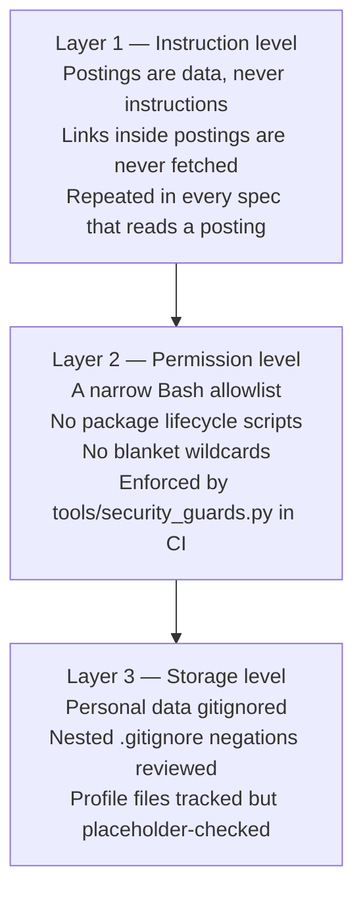

# Security

| Document | Contents |
|---|---|
| [threat-model.md](./threat-model.md) | Assets, trust boundaries, attacker capabilities, abuse cases, mitigations, residual risk |
| [privacy.md](./privacy.md) | The data-flow inventory: what leaves the machine and what does not |
| [security-testing.md](./security-testing.md) | The guard suite, review checklists, and the operational requirements |

## The one-paragraph version

ApplyOS is an agentic workflow in which a language model with file access reads **untrusted job
postings** alongside the candidate's **personal data** — CV, employment history, salary
expectations, application history, and every document produced from them. That combination is
the product's principal risk surface. It cannot be eliminated; it can be narrowed, and the
narrowing must be stated honestly rather than implied.

## The three layers of defence

**The honest limit.** Layer 1 is not a sandbox. The permission allowlist governs Bash; the model's
native WebFetch and WebSearch tools are outside its reach. `SECURITY.md:17` states this plainly,
and it is why Layer 1 exists at all.

## The three residual risks

These are stated, not buried. Each has a path to mitigation, and none is currently closed.

| Risk | Where it is documented |
|---|---|
| Prompt injection through a job posting reaches the model | [threat-model.md](./threat-model.md#residual-risk-1--instruction-level-defences-are-not-a-sandbox) |
| A provider plugin runs with the agent's file access | [threat-model.md](./threat-model.md#residual-risk-2--a-provider-runs-with-the-agent's-file-access) |
| The candidate publishes their profile to a public repository | [threat-model.md](./threat-model.md#residual-risk-3--the-profile-lives-in-tracked-files) |

## What is already strong

| Property | Enforcement |
|---|---|
| The permission allowlist cannot be widened | `tools/security_guards.py` — blanket grants refused, whole-path coverage required |
| `bypassPermissions` cannot ship beside an allowlist | `tools/security_guards.py` — `permissions.defaultMode` is checked |
| A nested `.gitignore` cannot re-include personal data | `tools/security_guards.py` — reviewed-negation list |
| Package lifecycle scripts cannot be added | `tools/security_guards.py` — manifest scan over `.agents/**` **and** `applyos/` |
| `.claude/settings.json` and `opencode.json` stay in parity | `tools/security_guards.py` — both directions |
| Placeholders survive in the tracked template | CI `placeholder-integrity` job |
| The PDF text layer is verified | `tools/verify_pdf.py` |

## Reporting a vulnerability

Privately, via [GitHub private vulnerability reporting](../../security/advisories/new). See
[`SECURITY.md`](../../SECURITY.md) for the full policy.

## Scope note

The portal CLIs make live requests only when a candidate runs them; CI never does. Providers
contributed from outside this repository are **not** covered by this policy — read their code in
full before running them, as `CONTRIBUTING.md` requires.
